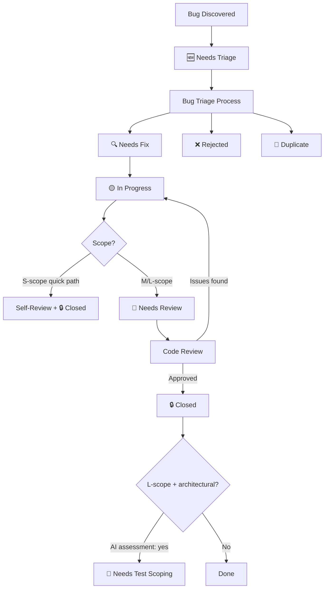

# Bug Tracking

This document tracks the lifecycle of bugs and issues in the LinkWatcher project, providing a systematic approach to bug identification, triage, resolution, and verification.

<strong>📋 Table of Contents</strong>

- [Status Legends](#status-legends)
  - [Bug Status](#bug-status)
  - [Priority Levels](#priority-levels)
  - [Scope Levels](#scope-levels)
  - [Source Types](#source-types)
- [Bug Management Workflow](#bug-management-workflow)
- [Bug Registry](#bug-registry)
  - [Critical Bugs](#critical-bugs)
  - [High Priority Bugs](#high-priority-bugs)
  - [Medium Priority Bugs](#medium-priority-bugs)
  - [Low Priority Bugs](#low-priority-bugs)
- [Closed Bugs](#closed-bugs) (pointer → [archive](archive/bug-tracking-archive.md))
- [Bug Statistics](#bug-statistics)

## Status Legends

### Bug Status

| Symbol | Status        | Description                                                    | Next Task  |
| ------ | ------------- | -------------------------------------------------------------- | ---------- |
| 🆕     | Needs Triage  | Bug reported, awaiting evaluation and prioritization           | PF-TSK-041 |
| 🔍     | Needs Fix     | Triaged and prioritized, ready for bug fixing                  | PF-TSK-007 |
| 🟡     | In Progress   | Bug is currently being investigated or fixed                   | —          |
| 👀     | Needs Review  | Fix implemented and tested, awaiting Code Review verification  | PF-TSK-005 |
| 🔒     | Closed        | Reviewed, verified, and resolved                               | —          |
| 🔄     | Reopened      | Previously closed bug has recurred — needs re-triage           | PF-TSK-041 |
| ❌     | Rejected      | Not a bug, won't fix, or other rejection rationale — terminal state | —     |
| 🚫     | Duplicate     | Duplicate of another existing bug — terminal state             | —          |

### Priority Levels

| Priority | Description                                 | Response Time     |
| -------- | ------------------------------------------- | ----------------- |
| Critical | System breaking, security issues            | Immediate         |
| High     | Major functionality affected                | Within 24 hours   |
| Medium   | Minor functionality affected                | Within 1 week     |
| Low      | Cosmetic or enhancement requests            | When time permits |

### Scope Levels

| Scope | Description                                                      |
| ----- | ---------------------------------------------------------------- |
| S     | Small — single-session fix, no state file needed                 |
| M     | Medium — may span sessions, state file recommended               |
| L     | Large — multi-session, state file required (New-BugFixState.ps1) |

### Source Types

| Source                 | Description                              |
| ---------------------- | ---------------------------------------- |
| Testing                | Discovered during test execution         |
| Test Development       | Found during test implementation         |
| Test Audit             | Discovered during test audit process     |
| E2E Testing            | Discovered during E2E acceptance testing |
| User Report            | Reported by end users                    |
| Code Review            | Found during code review process         |
| Feature Development    | Found during feature implementation      |
| Foundation Development | Found during foundational feature work   |
| Code Refactoring       | Discovered during refactoring activities |
| Deployment             | Found during release deployment          |
| Monitoring             | Detected by system monitoring            |
| Development            | Found during general development work    |

## Bug Management Workflow

## Bug Registry

### Critical Bugs

| ID | Title | Status | Priority | Scope | Reported | Description | Related Feature | Workflows | Dims | Notes |
| --- | --- | --- | --- | --- | --- | --- | --- | --- | --- | --- |
| _No critical bugs currently active_ |

### High Priority Bugs

| ID | Title | Status | Priority | Scope | Reported | Description | Related Feature | Workflows | Dims | Notes |
| --- | --- | --- | --- | --- | --- | --- | --- | --- | --- | --- |
| PD-BUG-157 | Control Panel exits silently when panel.port is stale, so the panel never opens | 🆕 Needs Triage | High |  | 2026-08-31 | The single-instance guard trusts panel.port without verifying that a process still listens on the recorded port. A stale file left behind by a killed panel makes every subsequent launch try to surface a non-existent window and then exit with no window, no console output and no error, so the panel appears completely broken. Deleting panel.port restores normal startup. A clean close removes the file, so only hard-killed panels leave one behind. | 7.1.1 | WF-010 | OB UX | Source: E2ETesting; Environment: Development; Component: Control Panel single-instance guard; Repro: 1. Launch the Control Panel and confirm the window opens. 2. Kill the panel process instead of closing the window (any hard kill), leaving <install>/panel.port on disk. 3. Launch the panel again by any route: python control_panel.py, the launcher, or the SessionStart hook. 4. Watch the terminal and the desktop.; Expected: Either a panel window opens, or the panel states why it declined to start. The guard should verify that a process is actually listening on the port recorded in panel.port before treating it as a live instance, and should recover on its own from a stale file.; Actual: No window opens, nothing is printed to the terminal, no error is raised, and the process exits. The only trace is <install>/logs/panel.log recording single_instance surfaced_existing port=NNNNN with no matching panel_started. The panel stays unusable until panel.port is deleted by hand.; Evidence: Observed 2026-08-31 during E2E execution of TE-E2E-034 and TE-E2E-035 under PF-TSK-070. C:\Users\ronny\bin\logs\panel.log shows surfaced_existing port=55310 at 08:48, 09:12, 09:17, 09:19, 14:20, 15:01, 15:25 and 16:32 with no panel_started entry all day. C:\Users\ronny\bin\panel.port held 55310 with no listening process. After deleting panel.port the next launch logged single_instance acquired port=61255 then panel_started, and the window opened. A normal close does remove panel.port (panel_exit shutdown_complete at 17:09:51 and 17:23:31, file gone both times), so a stale file originates from a killed panel. The TE-E2E-034 preconditions already tell the operator to delete a stale panel.port by hand, so the behavior was known but never filed. |

### Medium Priority Bugs

| ID | Title | Status | Priority | Scope | Reported | Description | Related Feature | Workflows | Dims | Notes |
| --- | --- | --- | --- | --- | --- | --- | --- | --- | --- | --- |
| _No medium priority bugs currently active_ |

### Low Priority Bugs

| ID | Title | Status | Priority | Scope | Reported | Description | Related Feature | Workflows | Dims | Notes |
| --- | --- | --- | --- | --- | --- | --- | --- | --- | --- | --- |
| _No low priority bugs currently active_ |

## Closed Bugs

> 🗄️ **Archived** — Closed and rejected bug rows live in [archive/bug-tracking-archive.md](archive/bug-tracking-archive.md) (sibling file, split 2026-05-26 per PF-IMP-872 to keep this file scannable as the closed/rejected history grows).
>
> `Update-BugStatus.ps1` reads and writes the archive automatically when transitioning to `Closed` / `Rejected` / `Reopened`. The archive holds two sections: `## Closed Bugs` (fixed) and `## Rejected Bugs` (not-a-bug / won't-fix) — kept distinct so trend analysis can separate "we fixed it" from "we decided not to fix it."

## Bug Statistics

### Current Status Summary

- **Total Active Bugs**: 1
- **Critical**: 0
- **High**: 1
- **Medium**: 0
- **Low**: 0
- **All Triaged**: Yes - no active bugs. PD-BUG-156 (validation scan silently skips every link target containing a space) was filed, TRIAGED to Low / scope S / OB / WF-009, FIXED and CLOSED all on 2026-08-31 via the S-scope quick path, human-approved at both checkpoints; it was filed the same day by Code Review of the PD-BUG-155 fix. The fix narrows the contains-whitespace skip predicate to exempt the explicit link types, reusing the frozenset BUG-088 had already introduced in that module for the same explicit-versus-heuristic distinction. Mutation-verified 1:1 against a no-op control that showed no harness artifact - reverting the predicate turns exactly the 8 new assertions red and nothing else, while the 7 guard assertions correctly stay green because the mutation restores what they pin. Full suite 1901 passed. A Step 20 sweep of all 12 skip predicates found no sibling defect: bare filename shows 114 resolving hits but is already link-type-aware by design. No E2E group flagged, measured rather than assumed. Triage confirmed validity with a discriminating control on one line of feature-tracking.md and corrected the record on three measured points: live exposure is 3 references rather than 2 and is not confined to the CommonMark angle form (the generated doc/PD-documentation-map.md line 70 carries a tight destination with a raw space); removing the predicate outright is NOT the fix, measuring plus 54 reported broken of which zero are genuine, so it must be narrowed to exempt the existing _EXPLICIT_LINK_TYPES set (plus 5 checked, plus 2 reported, both self-inflicted handbook examples); and the baseline scan already reports 1482 broken of 7432 checked, which argues against raising priority rather than for it. PD-BUG-150 was CLOSED 2026-08-31 at Code Review (PF-TSK-005) round 3: APPROVED, 0 Critical, its 1 Major routed to TD311 on human decision rather than a fourth round. That Major is the falsified wide-span bound surviving verbatim in the replace_in_line docstring - an uncovered fifth site where the round-3 record claims removal at all four, contradicting both its own module docstring and the type sets declared some 400 lines above it. No data is at risk: two damage oracles built independently at review (identity rewrite must be a byte-for-byte no-op, sentinel rewrite must be exactly reversible) report 0 damaged of 44673 references, and exactly 16 with _tighten_span disabled, all POWERSHELL_QUOTED_DIR and all under process-framework/scripts, reproducing the recorded count. The parser-side invariant was attacked a third time without success - by damage, by a 46251-reference span census showing 0 wide-by-whitespace spans, and by 38 constructed padded shapes across all seven parsers plus angle-bracket, tab, NBSP and quote-spanning variants. Both mutations reproduced 1:1 against the FULL suite (10 red without _tighten_span, exactly the padding tests; 2 red without the span.strip guard, exactly the indented reference-definition tests); full suite 1893 passed; manual validation 6 of 6 through the real service handler; 0 of 8881 E2E fixture references have a span the fix changes, so the no-E2E-re-execution call was re-measured for this delta rather than inherited. One Minor recorded not filed: the m.py row of the type-agnostic sweep test parses to zero references, so that row passes vacuously inside the very test that replaced the removed enumeration. PD-BUG-155 was CLOSED 2026-08-31 at Code Review (PF-TSK-005): APPROVED, 0 Critical / 0 Major, 3 Minor and 2 Suggestions, none blocking. The review re-measured the record rather than accepting it - the full suite reproduced at 1879 passed, and the mutation counts 12 (markdown capture unwrap) and 2 (PowerShell span narrowing) reproduced independently once a no-op control plugin established that a 15-test surplus was harness artifact, confirming the span narrowing load-bearing. The live exposure shape was driven end to end with a passing tight control. Findings were routed rather than reopening the fix: PD-BUG-156 for the validator whitespace skip, which leaves both live angle-wrapped instances following a move correctly yet unverifiable by any validation scan; two Minor residuals recorded in the PD-BUG-155 Notes cell (replace_markdown_target returns as soon as the angle variant matches, so its documented safety-net fallback loses a tight sibling on the same line, and an inner-padded destination is still left silently stale); and a stale TE-TST-165 row in test-tracking.md corrected under Step 26, having sat at Implementation In Progress with the blank test count that Validate-TestTracking passes over silently. PD-BUG-154 (updater markdown rewrite reaches past its span, overwriting a neighbouring link) was triaged AND CLOSED on 2026-08-31 - triaged to 🔍 Needs Fix, Low / scope S / DI CQ, then fixed the same session via the S-scope quick path, human-approved at the fix checkpoint after a recommendation to route it to Code Review instead was presented and not taken. The fix routes the MARKDOWN branch of replace_in_line to the span-confined replace_markdown_at_span, which also discharges the Minor that PD-BUG-153 Code Review left to it - the redundant call-site dispatch pre-emption - because both callers now reach span confinement through the shared entry point. 8 regression cases (TE-TST-164), 2 red pre-fix and 8 green post-fix, mutation-verified 1:1 in that reverting the one-line dispatch turns exactly those 2 red and leaves 1844 untouched; a second mutation splicing the bare target across the span turns 7 of 8 red, so the title and link-text guards cover the failure mode that got the first PD-BUG-150 fix rejected. Full suite 1846 passed. No E2E group flagged: behaviour-preserving for every reachable input. It was filed 2026-08-30 by the PD-BUG-153 fix at its Step 20 similar-issues check, as the same span-reach defect surviving on the updater path. Validity was confirmed by driving the real update_references_batch on repo source rather than accepting the filed repro, and the record was corrected on two points. The defect is NOT reachable from production input: its sole production caller is the directory-move Phase 1b batch, which can only emit uniformly prefixed moves, so the old-path and new-path sets are disjoint and the chain condition - one moved file landing exactly where another departed - cannot form; the two renames that would make those sets intersect are both refused by the OS. And the Workflows cell was narrowed from WF-001 WF-002 to WF-002, because single-file moves never reach the batch path at all. Priority was lowered Medium to Low on that reachability finding, priority governing urgency rather than importance. The fix is still warranted on structural grounds rather than corruption: replace_in_line is the documented shared entry point every caller should use, and it was the unsafe markdown path while the moved-file caller reached the safe replace_markdown_at_span - the exact divergence replacement.py was created to end. PD-BUG-152 was CLOSED 2026-08-31 at Code Review (PF-TSK-005): APPROVED, 0 Critical / 0 Major, 2 Minor and 1 Suggestion, none blocking. The review re-verified the seam rather than assuming it - PD-BUG-154 closed mid-review, moving MARKDOWN dispatch onto the span-confined replace_markdown_at_span after the 152 fix had been verified against the line-scoped path - and measured that a padded span is recorded INCLUDING its padding, so the shape guard passes and padded links inherit span confinement on both paths. Full suite 1852 passed; the manual validation re-ran 8 of 8 post-154; the recorded mutation counts 16 / 12 / 12 reproduced independently as 17 / 13 / 13 across three suites, with the four strip-only failures confirming the suite pins padding PRESERVATION separately from replacement. Its two Minor findings were routed rather than reopening the fix: PD-BUG-155 (angle-bracket destinations, the capture-side sibling of the same silent-stale-link class, and the first of this family with non-zero live exposure - 2 resolvable references in this repo) and TD308 / TD309. At that closure the remaining actives were PD-BUG-150 (🟡 In Progress) and PD-BUG-155 (🆕 Needs Triage); both have since closed. PD-BUG-153 was CLOSED 2026-08-31 at Code Review (PF-TSK-005): APPROVED, 0 Critical / 0 Major, 1 Minor and 1 Suggestion, neither blocking and neither filed as a new artifact - the Minor is the call-site dispatch pre-emption whose remedy PD-BUG-154 already owns. PD-BUG-153 (moved-file markdown rewrite leaves link text stale when it equals the old target) was triaged 2026-08-30 to 🔍 Needs Fix, Low / scope S / DI CQ. Validity was confirmed by driving the real moved-file path on repo source rather than accepting the filed repro, and the record was corrected on one point and extended on two: exposure independently re-measured at 258 self-named markdown links rather than the filed 213 (parser-based sweep of all 2021 markdown files; the filed count of 4 inert backtick-wrapped links matched), the stale text never self-heals and drifts further with each subsequent move, and --validate cannot detect it because that text is not registered as a separate reference. The Medium reading was presented and not taken - nothing corrupts and the link still resolves - but priority governs urgency only, and the fix is a one-line swap of Phase 2 onto the shared replace_markdown_target, verified additive-only against the five moved-file test files. PD-BUG-153 was originally filed by Code Review of the PD-BUG-150 rework as a pre-existing defect deliberately excluded from that verdict; PD-BUG-152 was filed by Code Review of the PD-BUG-151 fix — a padded inline markdown link is silently never re-depthed on a move, verified pre-existing by a paired run and so excluded from that verdict too. PD-BUG-151 was CLOSED 2026-08-30 at Code Review (PF-TSK-005): APPROVED, 0 Critical / 0 Major, 2 Minor and 3 Suggestions routed to TD306 and TD307, scope corrected S -> M at the closing call; PD-BUG-150 returned to 🟡 In Progress on 2026-08-30 when Code Review round 2 (PF-TSK-005) REJECTED the rework - 1 Major, the wide-span bound is wrong: POWERSHELL_QUOTED_DIR is a third link type whose recorded span exceeds its target, so a padded quoted directory silently loses the author whitespace when its file moves (regression confirmed against the pre-fix branch, 16 instances in this repo, 0 resolvable on disk so 0 corruptible today). PD-BUG-151 (whitespace-padded dot-only token evades the PD-BUG-149 guard, Medium) was triaged 2026-08-30 to 🔍 Needs Fix and FIXED the same day. Triage had corrected the filed description on three points (five affected parsers rather than three, with YAML and JSON corrupting structured config values; only depth 2+ is destructive, the one-level padded token being inert; exposure independently re-measured at zero corruptible instances) and recorded a deliberate fix-site departure - the shared root cause is padding captured into the reference span, but changing span capture would alter what column_start/column_end mean, which PD-BUG-150 had just made load-bearing. At the fix session the human partner OVERRODE that departure and took the root-cause option, folding TD305 in; TD305 is now Resolved. Two triage findings were superseded by measurement at the fix: the departure itself, and the zero-exposure figure - all 4 corruptible tokens sit in this file at line 123, the PD-BUG-151 entry itself, so filing the bug created the exposure. Scope was reassessed upward S -> M at the fix and the correction was applied at the Code Review closing call on 2026-08-30 (the archived row now reads M). Normalization now happens once in BaseParser.parse_content: 11 references dropped, 62 tightened, 0 added, measured paired across 88,359 references in both deployments; full suite 1801 passed. PD-BUG-150 (within-moved-file rewrite lands every replacement on the leftmost match, High / scope M) was fixed 2026-08-30 and returned to 🟡 In Progress the same day when Code Review (PF-TSK-005) REJECTED the fix: the position-blind replacement was correctly replaced with column-span replacement through a new shared module both rewrite paths use, ending the divergence that produced PD-BUG-118 through PD-BUG-120 and PD-BUG-098, but Phase 1 adopted the shared primitive without the type dispatch that guards it in updater.py, so MARKDOWN_REFERENCE (whose recorded span covers the whole line) now has its label and title overwritten — a Critical regression the fix introduced, silent, and invisible to a green 1767-test suite reporting 100 percent line coverage on the new module. The rework landed the same day (PF-TSK-007) and returned it to 👀 Needs Review: the link-type dispatch moved into linkwatcher.replacement beside the primitives it guards, so neither rewrite path can reach positional replacement without it, and the reviewed observability suggestion was fixed in the same change on human approval. The regression bound was re-measured independently rather than inherited - across 33 link-type shapes from seven parsers, MARKDOWN and MARKDOWN_REFERENCE are the only types whose span is wider than their target - and the rework was measured broader than filed: all three reference-definition shapes lose the whole label prefix, not only the title. Coverage is explicitly not the evidence this time: the 5 new tests are mutation-verified 1:1 against the mechanism, and the manual validation scores 3 of 5 against the rejected fix, because that fix passed every check the original fix shipped with. PD-BUG-149 (moved-file rewrite re-depths backtick-quoted ../ prose spans, filed 2026-08-29) was closed 2026-08-30 at Code Review (PF-TSK-005): the dot-only guard was verified at the shared predicate choke point reaching all seven parsers, full suite 1767 passed, 0 Critical/Major findings. Its one Minor finding — the guard is evaded by whitespace padding, with 0 corruptible instances measured across both deployments today — was routed as PD-BUG-151 rather than reopening the fix. PD-BUG-150 was split off at that same triage: it corrupts real links with no prose involved and is the mechanism behind the compounding observed in the PD-BUG-149 incident. PD-BUG-151 is newer, raised by the PD-BUG-149 code review itself. PD-BUG-148 was closed 2026-08-29 at Code Review round 6 (PF-TSK-005) after six rounds; its three residual Minor documentation findings were routed to TD304 rather than a seventh round. Full history in the bug-tracking archive.

---

## Integration with Feature Tracking

When bugs are related to specific features, they should reference the feature ID from [Feature Tracking](feature-tracking.md). This enables:

1. **Impact Assessment**: Understanding which features are affected by bugs
2. **Priority Alignment**: Aligning bug priority with feature priority
3. **Release Planning**: Ensuring critical bugs are fixed before feature releases
4. **Testing Coordination**: Coordinating bug fixes with feature testing

## Integration with Process Framework

This bug tracking system integrates with the following process framework components:

### Bug Management Tasks

- **[Bug Triage Task](../../../process-framework/tasks/06-maintenance/bug-triage-task.md)**: For bug evaluation and prioritization
- **[Bug Fixing Task](../../../process-framework/tasks/06-maintenance/bug-fixing-task.md)**: For bug resolution workflow

### Development Tasks with Bug Discovery Integration

- **[Data Layer Implementation (PF-TSK-051)](../../../process-framework/tasks/04-implementation/data-layer-implementation.md)**: Bug discovery during data model and repository work
- **[Integration & Testing (PF-TSK-053)](../../../process-framework/tasks/04-implementation/integration-and-testing.md)**: Bug discovery during integration testing and test development
- **[Implementation Finalization (PF-TSK-055)](../../../process-framework/tasks/04-implementation/implementation-finalization.md)**: Bug discovery during finalization
- **[Feature Enhancement (PF-TSK-068)](../../../process-framework/tasks/04-implementation/feature-enhancement.md)**: Bug discovery during enhancement work
- **[Foundation Feature Implementation Task](../../../process-framework/tasks/04-implementation/foundation-feature-implementation-task.md)**: Bug discovery during foundational work
- **[Test Audit Task](../../../process-framework/tasks/03-testing/test-audit-task.md)**: Bug discovery during test auditing
- **[Code Review Task](../../../process-framework/tasks/06-maintenance/code-review-task.md)**: Bug discovery during code reviews
- **[Code Refactoring Task](../../../process-framework/tasks/06-maintenance/code-refactoring-task.md)**: Bug discovery during refactoring
- **[Release Deployment Task](../../../process-framework/tasks/07-deployment/release-deployment-task.md)**: Bug discovery during deployment

### Automation Integration

All development tasks use the **`New-BugReport.ps1`** script for standardized bug reporting, ensuring consistent bug documentation and automatic integration with this tracking system.

## Usage Guidelines

### Adding New Bugs

#### Automated Method (Recommended)

Use the **`New-BugReport.ps1`** script for standardized bug creation:

- Automatically generates sequential PD-BUG-XXX IDs
- Ensures consistent formatting and required fields
- Integrates with development task workflows
- Creates bug report documents and updates this tracking file

#### Manual Method

1. Use the next sequential bug ID (PD-BUG-001, PD-BUG-002, etc.)
2. Start with status 🆕 Needs Triage
3. Fill in all required fields
4. Place in appropriate priority section
5. Reference related feature ID if applicable

### Updating Bug Status

1. Update the status symbol and any relevant fields
2. Add notes about status changes
3. Move bugs between priority sections if priority changes
4. Update statistics section

### Closing Bugs

Use `Update-BugStatus.ps1 -NewStatus "Closed"` which automatically:
1. Changes status to 🔒 Closed
2. Moves the bug entry from its active priority table to the Closed Bugs section
3. Recalculates Bug Statistics (active counts, resolved count)
4. Appends verification notes and timestamp

### Reopening Bugs

Use `Update-BugStatus.ps1 -NewStatus "Reopened" -ReopenReason "reason"` which automatically:
1. Changes status to 🔄 Reopened
2. Moves the bug entry from the Closed Bugs section back to the correct active priority table
3. Recalculates Bug Statistics (active counts, resolved count)
4. Appends reopen reason and timestamp

After reopening, re-evaluate priority and scope through [Bug Triage](../../../process-framework/tasks/06-maintenance/bug-triage-task.md#steps-to-reopen-a-bug).

### Bug ID Format

- **Format**: PD-BUG-XXX (where XXX is a sequential number)
- **Examples**: PD-BUG-001, PD-BUG-002, PD-BUG-003
- **Scope**: Project-wide unique identifiers following Product Documentation (PD) naming convention
- **Automated Creation**: When using `New-BugReport.ps1`, IDs are automatically generated in the correct format

---

_This document is maintained as part of the Process Framework State Tracking system and should be updated whenever bugs are reported, triaged, fixed, or closed._
