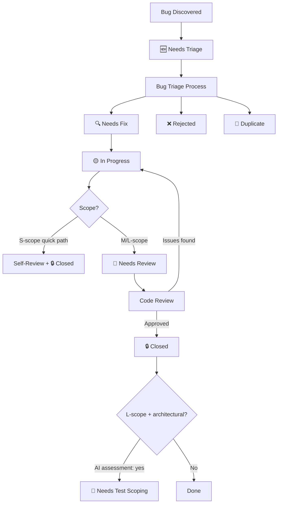

# Bug Tracking

This document tracks the lifecycle of bugs and issues in the LinkWatcher project, providing a systematic approach to bug identification, triage, resolution, and verification.

<strong>📋 Table of Contents</strong>

- [Status Legends](#status-legends)
  - [Bug Status](#bug-status)
  - [Priority Levels](#priority-levels)
  - [Scope Levels](#scope-levels)
  - [Source Types](#source-types)
- [Bug Management Workflow](#bug-management-workflow)
- [Bug Registry](#bug-registry)
  - [Critical Bugs](#critical-bugs)
  - [High Priority Bugs](#high-priority-bugs)
  - [Medium Priority Bugs](#medium-priority-bugs)
  - [Low Priority Bugs](#low-priority-bugs)
- [Closed Bugs](#closed-bugs) (pointer → [archive](archive/bug-tracking-archive.md))
- [Bug Statistics](#bug-statistics)

## Status Legends

### Bug Status

| Symbol | Status        | Description                                                    | Next Task  |
| ------ | ------------- | -------------------------------------------------------------- | ---------- |
| 🆕     | Needs Triage  | Bug reported, awaiting evaluation and prioritization           | PF-TSK-041 |
| 🔍     | Needs Fix     | Triaged and prioritized, ready for bug fixing                  | PF-TSK-007 |
| 🟡     | In Progress   | Bug is currently being investigated or fixed                   | —          |
| 👀     | Needs Review  | Fix implemented and tested, awaiting Code Review verification  | PF-TSK-005 |
| 🔒     | Closed        | Reviewed, verified, and resolved                               | —          |
| 🔄     | Reopened      | Previously closed bug has recurred — needs re-triage           | PF-TSK-041 |
| ❌     | Rejected      | Not a bug, won't fix, or other rejection rationale — terminal state | —     |
| 🚫     | Duplicate     | Duplicate of another existing bug — terminal state             | —          |

### Priority Levels

Critical / High / Medium / Low — set by Bug Triage (PF-TSK-041) from Impact × Frequency; before triage it holds the reporter's severity.

### Scope Levels

| Scope | Description                                                      |
| ----- | ---------------------------------------------------------------- |
| S     | Small — single-session fix                                       |
| M     | Medium — single-session fix                                      |
| L     | Large — multi-session fix                                        |

### Source Types

| Source                 | Description                              |
| ---------------------- | ---------------------------------------- |
| Testing                | Discovered during test execution         |
| Test Development       | Found during test implementation         |
| Test Audit             | Discovered during test audit process     |
| E2E Testing            | Discovered during E2E acceptance testing |
| User Report            | Reported by end users                    |
| Code Review            | Found during code review process         |
| Bug Triage             | Found while triaging another bug         |
| Feature Development    | Found during feature implementation      |
| Foundation Development | Found during foundational feature work   |
| Code Refactoring       | Discovered during refactoring activities |
| Deployment             | Found during release deployment          |
| Monitoring             | Detected by system monitoring            |
| Development            | Found during general development work    |

## Bug Management Workflow

## Bug Registry

### Critical Bugs

| ID | Title | Status | Priority | Scope | Reported | Description | Related Feature | Workflows | Dims | Notes |
| --- | --- | --- | --- | --- | --- | --- | --- | --- | --- | --- |
| _No critical bugs currently active_ |

### High Priority Bugs

| ID | Title | Status | Priority | Scope | Reported | Description | Related Feature | Workflows | Dims | Notes |
| --- | --- | --- | --- | --- | --- | --- | --- | --- | --- | --- |
| _No high priority bugs currently active_ |

### Medium Priority Bugs

| ID | Title | Status | Priority | Scope | Reported | Description | Related Feature | Workflows | Dims | Notes |
| --- | --- | --- | --- | --- | --- | --- | --- | --- | --- | --- |
| PD-BUG-161 | Opening VS Code starts a LinkWatcher daemon per open session instead of a single instance | 🆕 Needs Triage | Medium |  | 2026-09-29 | Reported: opening VS Code with several tabs open starts a LinkWatcher daemon for each, instead of one shared instance. Not reproduced at filing: a snapshot on 2026-09-29 shows exactly one daemon per project root (5 roots, 2 PIDs each = the known shim plus child pair), start times spread over hours. Triage must establish whether the symptom is same-root duplication (a PD-BUG-100 class defect) or one-daemon-per-project-root (designed, which would make this a feature request). | 0.1.1 |  |  | Evidence: Process snapshot 2026-09-29 15:20 local: 5 project roots (FrameworkBuilder, FrameworkBuilder/appdev, Letscape, TimeTrackingV2, LinkWatcher), 2 PIDs each = shim parent… [details](#pd-bug-161) |
| PD-BUG-162 | LinkWatcher rewrites the artifact lock store and races its lock | 🆕 Needs Triage | Medium |  | 2026-10-05 | LinkWatcher treats a framework workspace's artifact lock store (doc/state-tracking/artifact-locks.json) as a document: on a move of a locked file it rewrites the row's path from source to destination, and it writes the store by read-then-temp-file-replace outside the store's exclusive file handle, so a lock transaction landing between its read and write can be lost. The lock store is machine state owned by the locking scripts. | N/A |  |  | Reported 2026-10-05 (Monitoring) [details](#pd-bug-162) |
| PD-BUG-163 | PowerShell parser uses 3.10-only union syntax under requires-python >=3.9 | 🆕 Needs Triage | Medium |  | 2026-10-12 | src/linkwatcher/parsers/powershell.py:117 annotates _find_comment_start as "-> int \| None" without "from __future__ import annotations". pyproject.toml declares Python 3.9 supported (requires-python >=3.9, the 3.9 classifier, [tool.mypy] python_version 3.9). On 3.9 the annotation is evaluated when the function is defined and raises TypeError, and parsers/__init__.py imports this module at package import, so linkwatcher.parsers cannot load. | N/A |  |  | Reported 2026-10-12 (Development) [details](#pd-bug-163) |

### Low Priority Bugs

| ID | Title | Status | Priority | Scope | Reported | Description | Related Feature | Workflows | Dims | Notes |
| --- | --- | --- | --- | --- | --- | --- | --- | --- | --- | --- |
| _No low priority bugs currently active_ |

## Closed Bugs

> 🗄️ **Archived** — Closed and rejected bug rows live in [archive/bug-tracking-archive.md](archive/bug-tracking-archive.md) (sibling file, split 2026-05-26 per PF-IMP-872 to keep this file scannable as the closed/rejected history grows).
>
> `Update-BugStatus.ps1` reads and writes the archive automatically when transitioning to `Closed` / `Rejected` / `Reopened`. The archive holds two sections: `## Closed Bugs` (fixed) and `## Rejected Bugs` (not-a-bug / won't-fix) — kept distinct so trend analysis can separate "we fixed it" from "we decided not to fix it."

## Bug Statistics

### Current Status Summary

- **Total Active Bugs**: 3
- **Critical**: 0
- **High**: 0
- **Medium**: 3 (PD-BUG-161, PD-BUG-162, PD-BUG-163)
- **Low**: 0

## Bug Details

### PD-BUG-161

- **Source**: UserReport
- **Environment**: Development
- **Component**: Daemon Startup / Singleton Guard
- **Repro**: 1. Have several VS Code windows or tabs open, each running a Claude Code session. 2. Close VS Code and reopen it so every session restarts and each SessionStart hook fires. 3. Enumerate daemons: Get-CimInstance Win32_Process filtered to python processes whose command line contains main.py. 4. Group the results by their --project-root value and count distinct daemons per root.
- **Expected**: Exactly one LinkWatcher daemon per project root, regardless of how many editor tabs or agent sessions are open. Concurrent SessionStart hooks for the same root must collapse to a single live daemon.
- **Actual**: Reported as one daemon starting per open tab or session. At filing time the snapshot instead showed one daemon per project root across 5 distinct roots, so same-root duplication was not observable several hours after the reported VS Code start; the reported burst, if real, either self-resolved or was one-per-project rather than one-per-tab.
- **Evidence**: Process snapshot 2026-09-29 15:20 local: 5 project roots (FrameworkBuilder, FrameworkBuilder/appdev, Letscape, TimeTrackingV2, LinkWatcher), 2 PIDs each = shim parent plus interpreter child per PF-IMP-1682, i.e. one daemon per root. Guard sites: launcher process-framework/tools/linkWatcher/start_linkwatcher_background.ps1 (framework-owned, FWK-FB) and product-side atomic acquire_lock in main.py (O_CREAT/O_EXCL, PD-BUG-099). Closest prior bug: PD-BUG-100.

### PD-BUG-162

- **Source**: Monitoring · **Environment**: Production · **Component**: Link updater (JSON state files)
- **Repro**: 1) In a framework workspace with locking enabled (e.g. FrameworkBuilder), check out a guarded file with Checkout-Artifact.ps1. 2) Move that file (Move-Item or git mv) while the LinkWatcher daemon runs. 3) Read doc/state-tracking/artifact-locks.json: the lock row now names the destination path. 4) Release-ArtifactLock.ps1 -Path <source> fails with "is not checked out".
- **Expected**: LinkWatcher leaves machine-written state stores untouched (no link rewriting in doc/state-tracking/artifact-locks.json), or at minimum never writes a file another process holds under an exclusive handle without that lock. A per-file ignore (today only ignored_directories, matched per path component, exists) would let workspaces exclude such stores.
- **Actual**: Lock rows are re-pointed on moves (observed twice on 2026-10-05 at FrameworkBuilder), and the store is rewritten with an unlocked read-modify-write (updater.py _write_file_safely: NamedTemporaryFile then shutil.move, which on Windows falls back to copy over the existing file). Logs also show hundreds of Permission denied reads of the store per day while the locking scripts hold it.
- **Evidence**: Cross-project origin: found at FrameworkBuilder (FWK-FB) during Framework Extension PF-TSK-026 for PF-IMP-2331 (concept PF-PRO-086 Multi-Path Locking), 2026-10-05; owner directed filing here. FB LinkWatcher logs: LinkWatcherLog_20261005-140048.txt 11:23:46 and LinkWatcherLog_20261005-185801.txt 18:41:50 - move_detected then links_updated file_path=doc/state-tracking/artifact-locks.json references_updated=1; a following Release-ArtifactLock of the source failed "is not checked out". Source: src/linkwatcher/updater.py L341 (plain open read) and L516-543 (_write_file_safely); src/linkwatcher/config/settings.py L285 (ignored_directories is the only exclusion). The lost-update frequency is unmeasured - no lost row observed. Locking side: PF-PRO-086 makes release tolerate the re-point; the store write race remains LinkWatcher-side.

### PD-BUG-163

- **Source**: Development · **Environment**: Development · **Component**: Parsers
- **Repro**: Under a Python 3.9 interpreter, from the project root: python -c "import sys; sys.path.insert(0, 'src'); import linkwatcher.parsers"
- **Expected**: The package imports on every Python version pyproject.toml declares.
- **Actual**: TypeError: unsupported operand type(s) for |: type and NoneType at import (static finding, see Evidence).
- **Evidence**: Cross-project from FrameworkBuilder PF-IMP-2589 (2026-10-12), whose verification ran python -m mypy src/linkwatcher with the project's own [tool.mypy] config: "X | Y syntax for unions requires Python 3.10 [syntax]" at parsers/powershell.py:117. Not reproduced at runtime: no Python 3.9 interpreter is installed on this machine. The same run reported 369 other findings (249 missing annotations), context if the project adopts the new typeCheckCommand warn-first.

---

## Integration with Feature Tracking

When bugs are related to specific features, they should reference the feature ID from [Feature Tracking](feature-tracking.md). This enables:

1. **Impact Assessment**: Understanding which features are affected by bugs
2. **Priority Alignment**: Aligning bug priority with feature priority
3. **Release Planning**: Ensuring critical bugs are fixed before feature releases
4. **Testing Coordination**: Coordinating bug fixes with feature testing

## Integration with Process Framework

This bug tracking system integrates with the following process framework components:

### Bug Management Tasks

- **[Bug Triage Task](../../../process-framework/tasks/06-maintenance/bug-triage-task.md)**: For bug evaluation and prioritization
- **[Bug Fixing Task](../../../process-framework/tasks/06-maintenance/bug-fixing-task.md)**: For bug resolution workflow

### Development Tasks with Bug Discovery Integration

- **[Data Layer Implementation (PF-TSK-051)](../../../process-framework/tasks/04-implementation/data-layer-implementation.md)**: Bug discovery during data model and repository work
- **[Integration & Testing (PF-TSK-053)](../../../process-framework/tasks/04-implementation/integration-and-testing.md)**: Bug discovery during integration testing and test development
- **[Implementation Finalization (PF-TSK-055)](../../../process-framework/tasks/04-implementation/implementation-finalization.md)**: Bug discovery during finalization
- **[Feature Enhancement (PF-TSK-068)](../../../process-framework/tasks/04-implementation/feature-enhancement.md)**: Bug discovery during enhancement work
- **[Foundation Feature Implementation Task](../../../process-framework/tasks/04-implementation/foundation-feature-implementation-task.md)**: Bug discovery during foundational work
- **[Test Audit Task](../../../process-framework/tasks/03-testing/test-audit-task.md)**: Bug discovery during test auditing
- **[Code Review Task](../../../process-framework/tasks/06-maintenance/code-review-task.md)**: Bug discovery during code reviews
- **[Code Refactoring Task](../../../process-framework/tasks/06-maintenance/code-refactoring-task.md)**: Bug discovery during refactoring
- **[Release Deployment Task](../../../process-framework/tasks/07-deployment/release-deployment-task.md)**: Bug discovery during deployment

### Automation Integration

All development tasks use the **`New-BugReport.ps1`** script for standardized bug reporting, ensuring consistent bug documentation and automatic integration with this tracking system.

## Usage Guidelines

### Adding New Bugs

#### Automated Method (Recommended)

Use the **`New-BugReport.ps1`** script for standardized bug creation:

- Automatically generates sequential PD-BUG-XXX IDs
- Ensures consistent formatting and required fields
- Integrates with development task workflows
- Creates bug report documents and updates this tracking file

#### Manual Method

1. Use the next sequential bug ID (PD-BUG-001, PD-BUG-002, etc.)
2. Start with status 🆕 Needs Triage
3. Fill in all required fields
4. Place in appropriate priority section
5. Reference related feature ID if applicable

### Updating Bug Status

1. Update the status symbol and any relevant fields
2. Add notes about status changes
3. Move bugs between priority sections if priority changes
4. Update statistics section

### Closing Bugs

Use `Update-BugStatus.ps1 -NewStatus "Closed"` which automatically:
1. Changes status to 🔒 Closed
2. Moves the bug entry from its active priority table to the Closed Bugs section
3. Recalculates Bug Statistics (active counts, resolved count)
4. Appends verification notes and timestamp

### Reopening Bugs

Use `Update-BugStatus.ps1 -NewStatus "Reopened" -ReopenReason "reason"` which automatically:
1. Changes status to 🔄 Reopened
2. Moves the bug entry from the Closed Bugs section back to the correct active priority table
3. Recalculates Bug Statistics (active counts, resolved count)
4. Appends reopen reason and timestamp

After reopening, re-evaluate priority and scope through [Bug Triage](../../../process-framework/tasks/06-maintenance/bug-triage-task.md#steps-to-reopen-a-bug).

### Bug ID Format

- **Format**: PD-BUG-XXX (where XXX is a sequential number)
- **Examples**: PD-BUG-001, PD-BUG-002, PD-BUG-003
- **Scope**: Project-wide unique identifiers following Product Documentation (PD) naming convention
- **Automated Creation**: When using `New-BugReport.ps1`, IDs are automatically generated in the correct format

---

_This document is maintained as part of the Process Framework State Tracking system and should be updated whenever bugs are reported, triaged, fixed, or closed._
