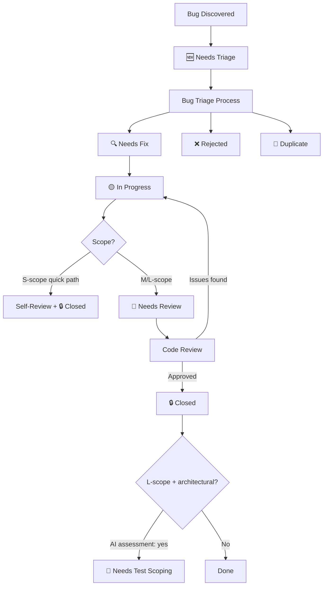

# Bug Tracking

This document tracks the lifecycle of bugs and issues in the LinkWatcher project, providing a systematic approach to bug identification, triage, resolution, and verification.

<strong>📋 Table of Contents</strong>

- [Status Legends](#status-legends)
  - [Bug Status](#bug-status)
  - [Priority Levels](#priority-levels)
  - [Scope Levels](#scope-levels)
  - [Source Types](#source-types)
- [Bug Management Workflow](#bug-management-workflow)
- [Bug Registry](#bug-registry)
  - [Critical Bugs](#critical-bugs)
  - [High Priority Bugs](#high-priority-bugs)
  - [Medium Priority Bugs](#medium-priority-bugs)
  - [Low Priority Bugs](#low-priority-bugs)
- [Closed Bugs](#closed-bugs) (pointer → [archive](archive/bug-tracking-archive.md))
- [Bug Statistics](#bug-statistics)

## Status Legends

### Bug Status

| Symbol | Status        | Description                                                    | Next Task  |
| ------ | ------------- | -------------------------------------------------------------- | ---------- |
| 🆕     | Needs Triage  | Bug reported, awaiting evaluation and prioritization           | PF-TSK-041 |
| 🔍     | Needs Fix     | Triaged and prioritized, ready for bug fixing                  | PF-TSK-007 |
| 🟡     | In Progress   | Bug is currently being investigated or fixed                   | —          |
| 👀     | Needs Review  | Fix implemented and tested, awaiting Code Review verification  | PF-TSK-005 |
| 🔒     | Closed        | Reviewed, verified, and resolved                               | —          |
| 🔄     | Reopened      | Previously closed bug has recurred — needs re-triage           | PF-TSK-041 |
| ❌     | Rejected      | Not a bug, won't fix, or other rejection rationale — terminal state | —     |
| 🚫     | Duplicate     | Duplicate of another existing bug — terminal state             | —          |

### Priority Levels

| Priority | Description                                 | Response Time     |
| -------- | ------------------------------------------- | ----------------- |
| Critical | System breaking, security issues            | Immediate         |
| High     | Major functionality affected                | Within 24 hours   |
| Medium   | Minor functionality affected                | Within 1 week     |
| Low      | Cosmetic or enhancement requests            | When time permits |

### Scope Levels

| Scope | Description                                                      |
| ----- | ---------------------------------------------------------------- |
| S     | Small — single-session fix, no state file needed                 |
| M     | Medium — may span sessions, state file recommended               |
| L     | Large — multi-session, state file required (New-BugFixState.ps1) |

### Source Types

| Source                 | Description                              |
| ---------------------- | ---------------------------------------- |
| Testing                | Discovered during test execution         |
| Test Development       | Found during test implementation         |
| Test Audit             | Discovered during test audit process     |
| E2E Testing            | Discovered during E2E acceptance testing |
| User Report            | Reported by end users                    |
| Code Review            | Found during code review process         |
| Feature Development    | Found during feature implementation      |
| Foundation Development | Found during foundational feature work   |
| Code Refactoring       | Discovered during refactoring activities |
| Deployment             | Found during release deployment          |
| Monitoring             | Detected by system monitoring            |
| Development            | Found during general development work    |

## Bug Management Workflow

## Bug Registry

### Critical Bugs

| ID | Title | Status | Priority | Scope | Reported | Description | Related Feature | Workflows | Dims | Notes |
| --- | --- | --- | --- | --- | --- | --- | --- | --- | --- | --- |
| _No critical bugs currently active_ |

### High Priority Bugs

| ID | Title | Status | Priority | Scope | Reported | Description | Related Feature | Workflows | Dims | Notes |
| --- | --- | --- | --- | --- | --- | --- | --- | --- | --- | --- |
| _No high priority bugs currently active_ |

### Medium Priority Bugs

| ID | Title | Status | Priority | Scope | Reported | Description | Related Feature | Workflows | Dims | Notes |
| --- | --- | --- | --- | --- | --- | --- | --- | --- | --- | --- |
| _No medium priority bugs currently active_ |

### Low Priority Bugs

| ID | Title | Status | Priority | Scope | Reported | Description | Related Feature | Workflows | Dims | Notes |
| --- | --- | --- | --- | --- | --- | --- | --- | --- | --- | --- |
| _No low priority bugs currently active_ |

## Closed Bugs

> 🗄️ **Archived** — Closed and rejected bug rows live in [archive/bug-tracking-archive.md](archive/bug-tracking-archive.md) (sibling file, split 2026-05-26 per PF-IMP-872 to keep this file scannable as the closed/rejected history grows).
>
> `Update-BugStatus.ps1` reads and writes the archive automatically when transitioning to `Closed` / `Rejected` / `Reopened`. The archive holds two sections: `## Closed Bugs` (fixed) and `## Rejected Bugs` (not-a-bug / won't-fix) — kept distinct so trend analysis can separate "we fixed it" from "we decided not to fix it."

## Bug Statistics

### Current Status Summary

- **Total Active Bugs**: 0
- **Critical**: 0
- **High**: 0
- **Medium**: 0
- **Low**: 0
- **All Triaged**: Yes - no active bugs remain (PD-BUG-140 closed 2026-08-27 after code review). PD-BUG-147 was triaged 2026-08-27 and CLOSED the same day via the Bug Fixing S-scope quick path (PF-TSK-007), human-approved at both the Step 11 and Step 23 checkpoints; full fix rationale in its archive row. Its triage was 2026-08-27 via Bug Triage (PF-TSK-041), human approved as recommended: priority Low HELD, scope S assigned (was blank), related feature 1.1.1 and Dims DA held, workflows WF-008 and WF-010 held with a caveat. Validity confirmed against all four cited facts - the clause exists at capabilities-reference lines 195-197, the watch-liveness feature is unreleased (latest tag v2.1.3 dated 2026-06-22, pyproject at 2.2.0, liveness.py still untracked), a sweep of retrospective phrasings across doc/user/handbooks returned exactly one unfounded instance, and the Issue Classification and Routing Guide line 75 confirms product bug as the tracker. Low HELD over the defensible raise the same-family PD-BUG-138 received (Medium to High on a silently-passing-test reading), because the inference chain here is long and indirect, no behaviour is wrong, the consequence is self-correcting, nothing is institutionalized in an approved artifact and no release path is gated. Description corrected on three points: the UNDERSTATED harm is that this clause is the only version-dating statement in the whole Watch Liveness Monitoring section and dates the feature backwards, so a reader on v2.1.x can infer stall detection they do not have and no CHANGELOG exists to correct them; PRECISION added that v2.1.3 predates BOTH fixes, so what makes this instance unfounded is the contrasted prior behaviour never having shipped rather than the fix being unreleased, recorded so a fixer does not over-correct and strip the founded lines 48 and 100; and SCOPE verified as genuinely one site, the TDD parallel passage carrying no retrospective version claim. Workflows held as documentation subject matter rather than behavioural blast radius - no E2E re-execution is implied by the fix. Not a duplicate and not a reopen of PD-BUG-145: a new inaccuracy that fix introduced while correcting two other statements, per the Reopen Workflow different-root-cause rule. Full rationale in the PD-BUG-147 Notes cell. PD-BUG-146 was triaged 2026-08-27 via Bug Triage (PF-TSK-041), human approved as recommended: priority Medium HELD, scope S assigned (was blank), related feature 0.1.1 and workflow WF-008 held, Dims CORRECTED CQ OB to CQ DA because the product logging is not defective and the defect is documented-vs-actual misalignment. Description corrected on three points: TWO pass criteria are unsatisfiable rather than one (the shutdown log message AND exited with code 0, measured at -1 under Stop-Process -Force, both mirrored again in Behavioral Outcomes); the case is recorded Passed AND Audit Approved (TE-TAR-048, whose report calls the four criteria 4 measurable conditions and records No issues found); and the sibling check requested at filing is done - TE-E2E-022 is clean, TE-E2E-021 carries a weaker Behavioral-Outcomes instance folded into the same fix rather than filed separately. Held Medium rather than RAISED to High as the same-family PD-BUG-138 was, because that fixture verified nothing while reporting a pass whereas this one verifies file non-corruption for real and merely claims more than it verifies; the unverified Ctrl+C path is unreachable by any operator tool (every stop path is a hard kill - lifecycle.py line 8, service.py lines 142-143, stop_linkwatcher.ps1 line 45), so the harness mirrors the product rather than deviating from it; and no release path is gated (0.1.1 Completed with All Passing, WF-008 is P2). Full rationale in the PD-BUG-146 Notes cell. PD-BUG-144 was closed 2026-08-27 via the Bug Fixing S-scope quick path (PF-TSK-007), human-approved at the Step 23 checkpoint; full rationale in its archive row. PD-BUG-145 was triaged 2026-08-27 via Bug Triage (PF-TSK-041), human approved as recommended: priority Low HELD, scope S, related feature 1.1.1 held, Dims CORRECTED OB to OB DA, workflows POPULATED from blank to WF-008 and WF-010. Validity confirmed - all five cited sites verified in code: _remove_liveness_sentinel is called only from stop() (service.py line 294), stop_linkwatcher.ps1 line 45 force-kills with Stop-Process -Force, lifecycle.py line 505 uses psutil terminate whose own module docstring calls it a hard TerminateProcess, the service.py line 309 docstring claims removal runs after the observer has stopped while the call sits above observer.stop(), and capabilities-reference.md line 190 states the probe is removed when the daemon stops. Description corrected on two counts, both OVERSTATEMENTS: the probe outlives only those stops that followed at least one probe write, because the silence gate (watch_liveness_idle_seconds, 60s default) never opens on an active project and no probe is ever written, so the blast radius is idle projects only; and the service.py line 309 docstring is inaccurate about ordering INSIDE stop() independently of the force-kill paths, making it a co-located inaccuracy from the same session rather than a consequence. Severity ceiling checked and ruled out, which is why this stays Low rather than High: a leftover sentinel cannot cause a false stall on the next daemon, because handler.dispatch matches on src_path regardless of event type, so truncating an existing sentinel still produces a matching MODIFY event and the probe registers as observed. Default deployments are benign - the leftover lands in the daemon own-output log directory that users already ignore - and the user-visible harm is confined to fallback deployments (log at the project root or outside the project), where it surfaces as an untracked dotfile in the repository root. Dims DA added because two statements contradict the code and one of them is user-facing; OB retained as the subsystem, CQ deliberately not added since PD-BUG-144 already carries it for the stop() structure. Related feature 1.1.1 HELD rather than corrected to 0.1.1 as PD-BUG-144 was on the same day, and the divergence is deliberate: that bug concerns the service own shutdown sequence, which Core Architecture owns, whereas this one concerns the liveness probe lifecycle - PD-BUG-139 filed the same subsystem against 1.1.1, FDD edge case 1.1.1-EC-11 documents the liveness contract, and the 1.1.1 state file carries liveness.py in its code inventory. Not a duplicate, but COUPLED to PD-BUG-144: the sentinel cleanup was deliberately hoisted above the if self.running guard to escape that defect, so the PD-BUG-144 fix that moves the guard to a dedicated idempotence flag must not silently drop the hoisted call. Fixer caution recorded on the suggested unlink-at-startup fix: _liveness_sentinel_path pins its answer for the daemon lifetime based on whether the log directory exists yet, so an unlink placed before logging setup would pin the project-root fallback and relocate the probe for EVERY deployment; verified safe inside start() because setup_logging (main.py line 505) precedes service construction (line 539). Full rationale in the PD-BUG-145 Notes cell. PD-BUG-144 was triaged 2026-08-27 via Bug Triage (PF-TSK-041), human approved as recommended: priority Medium HELD, scope S, Dims OB CQ held, related feature CORRECTED 1.1.1 to 0.1.1, workflow CORRECTED WF-010 to WF-008. Validity confirmed and reproduced at two levels - a unit probe showing observer.stop, observer.join and the final statistics all skipped with zero log events when running is cleared first, and a real-observer end-to-end in which the WindowsApiObserver is STILL ALIVE after stop() returns, which is the non-mock proof that the guarded body never ran; both controls behave correctly. Description corrected on four points, decisively on the workflow: the filed WF-010 is wrong because the Control Panel stops daemons with a hard TerminateProcess (lifecycle.py line 505, and the module docstring states there is no graceful cross-process signal), so under the panel stop() never runs at all and the bug is invisible on WF-010 - as it is under stop_linkwatcher.ps1, which uses Stop-Process -Force. The correct workflow is WF-008 Graceful shutdown, whose documented trigger reads literally Stop the LinkWatcher process (Ctrl+C, kill); the affected paths are a foreground Ctrl+C run, the PD-BUG-139 liveness self-stop and the PD-BUG-018 observer-thread-died stop. Also: the leftover observer thread is harmless because WindowsApiObserver.daemon is True and the lock is released by the main.py finally block, so nothing hangs and nothing leaks (OVERSTATED); the real harm is that this partially defeats PD-BUG-139, whose purpose is that a blind daemon stops LOUDLY, since the log now ends at observer_emitter_died with no shutdown confirmation (UNDERSTATED); and the except KeyboardInterrupt branches in start() and main() are effectively dead code, because register_signals defaults True so SIGINT reaches _signal_handler and never raises. Priority Medium held over a defensible High reading (a P2 workflow whose own documented trigger never executes its shutdown sequence, deterministic on every affected path) because the WF-008 acceptance criterion is no corrupted files and that criterion holds - files intact, lock released, process exits cleanly - so what fails is the instrumentation rather than the promise, and this project runs the daemon detached and stops it by hard kill. Consistent with PD-BUG-137, held Medium as something that misleads rather than breaks. Related feature corrected because service.py is owned by Core Architecture, whose state file names LinkWatcherService as the central component. Scope S with no open design fork: the guard moves from the mutable running flag to a dedicated idempotence flag, and test_si_002_service_multiple_stop_calls already constrains the design by pinning three consecutive stop() calls on a never-started service. Not a duplicate and not a reopen of PD-BUG-018 - that bug was about detecting a dead observer, this is the shutdown sequence being skipped afterward. Observation recorded, not filed: the WF-008 E2E group is Covered 3 of 3 and passing while the graceful-shutdown sequence never runs on its own trigger, because its cases verify file non-corruption rather than that shutdown completed. Full rationale in the PD-BUG-144 Notes cell. PD-BUG-143 was triaged 2026-08-27 via Bug Triage (PF-TSK-041), human approved as recommended: priority Medium HELD, scope S, Dims CORRECTED DA to AC OB CQ, related feature 0.1.3 and workflow WF-006 held. Validity confirmed by direct measurement across six fields spanning bool, float and str - with the file at move_detect_delay 25 and LINKWATCHER_MOVE_DETECT_DELAY=10 the effective value is 25, where the control at env 30 resolves 30.0, and file dry_run_mode true with env false still resolves True. Description corrected on five points, decisively on breadth: this is not the corner case the title suggests - for all 17 boolean fields (44 percent of the 39-field schema) the environment can NEVER reverse a config-file setting in either direction, because a boolean has only two values and the counter-value to a non-default file setting IS the default. Measured against the shipped config-examples/production-config.yaml, three environment overrides are discarded while from_env alone reads all three correctly, proving the loss is at merge and not at parsing. Also: dry_run_mode has no escape at all once a config file enables it, since --dry-run only sets True and there is no --no-dry-run; the silent claim holds but because print_startup_info returns early when colored_output is false and prints to stdout rather than logging; the CLI layer is NOT affected, so env-over-file is the sole live surface; and the handbook troubleshooting entry Environment variable ignored misdirects to naming and format. Priority Medium held over a strict matrix reading of High (Impact High x Frequency Low) for consistency with PD-BUG-142, a strictly narrower instance of the same class held at Medium one day earlier - the environment layer is effectively unused here, the config file surface is unaffected, nothing is corrupted, and the workaround is free. Dims corrected out of DA because the documentation is right and the code is wrong. Scope S with the design fork resolved in favour of tracking explicitly-set fields via __setattr__ rather than inferring from value not-equal default; no existing test pins the buggy behavior. Not a duplicate and not a reopen - PD-BUG-123, 127, 128 and 129 are the same silent-config-failure family but all four are validate() hardcoding versus schema derivation, whereas this is merge(). Sequence BEFORE PD-BUG-142, whose approved M path publishes the daemon effective move_detect_delay and would otherwise inherit this defect. Full rationale in the PD-BUG-143 Notes cell. PD-BUG-142 was triaged 2026-08-27 via Bug Triage (PF-TSK-041), human approved as recommended: priority Medium HELD, scope M, Dims DI ID held, related feature 7.1.1, workflows widened from WF-010 alone to WF-010 plus WF-006. Validity confirmed by direct measurement - with the file omitting move_detect_delay or setting 10 and LINKWATCHER_MOVE_DETECT_DELAY=30, the daemon resolves 30.0 while read_correlation_window returns 10.0. Description corrected on three points: the divergence runs in BOTH directions (env below the file value makes the panel over-wait, raising the chance of a FORCE_STOPPED where a clean stop was available); the env surface is not fully live, since merge skips a value equal to the dataclass default, which is the spun-off PD-BUG-143; and decisively, the cheap os.environ fix the report proposes is INCOMPLETE, because the panel adopts daemons it never started (discovery.py line 303) and this project starts its own daemon from a SessionStart hook, while the daemon publishes no effective-config surface (config_loaded logs the path only, the lock holds a bare PID). Priority Medium held over a strict matrix reading of High (Impact High x Frequency Low) because the trigger is a deliberate opt-in configuration act with zero occurrences anywhere in the product, launchers, installer, docs or config examples, unlike the rare-but-spontaneous trigger on which PD-BUG-139 held High. Scope M rather than S because the fix carries a design fork; the approved M path has the daemon publish its effective move_detect_delay for the panel to read, closing the F2 residual and subsuming TD294. Not a duplicate and not a reopen of PD-BUG-136 - the root cause lives in read_correlation_window, code that did not exist before that fix. Sequence after PD-BUG-141. Full rationale in the PD-BUG-142 Notes cell. PD-BUG-141 was triaged 2026-08-26 via Bug Triage (PF-TSK-041), human approved: priority RAISED Low to Medium, scope S, with Dims DI OB ID, related feature 1.1.1 and workflows WF-001/WF-002/WF-004/WF-005/WF-011 all held as filed. Validity confirmed by direct measurement - _is_observed_path_deleted is a constant-true predicate, returning True for a healthy, a deleted and a moved watch root alike. Description corrected on two points: a naive VOLUME_NAME_DOS swap does NOT fix it (the returned path carries a device-namespace prefix, so the healthy case still compares unequal), and the underlying OSError is swallowed entirely, so a firing surfaces only as observer_emitter_died with no winerror - the one part of this bug the PD-BUG-139 detector does not bound, and the decisive reason for Medium over Low. Frequency Low established empirically: zero watch-root firings across all retained logs, and a synchronous ReadDirectoryChangesW buffer overflow was measured to return zero bytes rather than raise, ruling out the one plausible high-frequency trigger. Not a duplicate of the closed PD-BUG-018 - same class, different mechanism at the handler and observer level - so a new bug rather than a reopen. Full rationale in the PD-BUG-141 Notes cell. PD-BUG-139 and PD-BUG-140 (filed 2026-08-25 during Bug Fixing of PD-BUG-136 as empirical findings that did not fit that bug) were triaged 2026-08-25 via Bug Triage (PF-TSK-041), human approved. PD-BUG-139: priority High held (impact High, frequency Low), scope L, Dims DI OB ID, workflows widened from WF-010 alone to WF-001/WF-002/WF-004/WF-005/WF-010/WF-011 because a blind daemon breaks every move-driven workflow. Validity confirmed against the preserved evidence - the move did execute and left docs/guide.md stale, so this is not a no-op fixture like PD-BUG-138 - and the signature was corrected to alive-but-not-delivering (the observer replayed 2 deferred events at startup, then went silent for 34 s with no observer_thread_died record from the 1 s health poll). Cross-referenced to the closed PD-BUG-018 as the same class with a different mechanism; not reopened per the Reopen Workflow. Scope L because the root cause is unproven after 3 failed reproductions and the realistic fix is a new delivery-level liveness mechanism. PD-BUG-140: priority Medium held, scope M, Dims DI OB, workflows WF-002 and WF-010. Tracker confirmed correct per the Issue Classification and Routing Guide - broken existing behavior against FDD 7-1-1-BR-3 - despite one candidate resolution being new functionality. Medium not High because the damage is bounded (updates dropped, never corrupted) and recoverable via a validate run, and the trigger is rare; this reconciles with PD-BUG-136 being High on the same impact but a deterministic trigger. Scope M because the first move is a design decision between document, warn-on-close and cooperative stop sentinel, and BR-3 versus BR-7 must be resolved in the FDD rather than in code. PD-BUG-136, PD-BUG-137 and PD-BUG-138 triaged 2026-08-25 via Bug Triage (PF-TSK-041), human approved; all three were filed 2026-08-25 from E2E acceptance testing of WF-010 against feature 7.1.1, and all three block that workflow's E2E sign-off (its E2E status is already Failing). PD-BUG-136: priority High held, scope M, Dims DI ID, workflow WF-010. The competing reading recorded in the report - that the test closes the panel too early - was REFUTED at triage by arithmetic: watch_quiescence judges quiescence solely by the log (path,size,mtime) signature and log_idle_threshold_seconds=3.0 is less than move_detect_delay=10s, so a buffered move-correlation can never survive a drain begun inside the correlation window, and FDD 7-1-1-BR-3 names buffered move-correlations explicitly as work the drain must let finish. Evidence corrected: the filed zero-file-events claim is contradicted by file_deleted logging at INFO, so a stale or rotated log was most likely read. [SUPERSEDED 2026-08-25 at PD-BUG-139 triage: that stale-or-rotated-log reading is wrong - exactly one complete log file exists and it genuinely ends at monitoring_started. The zero-file-events observation was real and is tracked as PD-BUG-139.] Scope M because the panel has no existing seam for the daemon correlation window - zero move_detect_delay references anywhere in the panel package - so the fix adds a cross-component config dependency plus tests plus an E2E re-run. Not Critical: files stay intact, so the BR-7 no-corruption clause holds. PD-BUG-137: priority Medium held (Impact Low x Frequency High - acquire_lock reclaims a dead-PID lock automatically and the panel surfaces STALE_LOCK, so this misleads rather than breaks), scope S, Dims DI OB, workflow WF-010. Narrowed to three silent False exits in cleanup_lock, with a swallowed unlink OSError the leading candidate since the logged PID is in the terminated tuple and the 3.36s timing rules out an exit-wait timeout. Confirmed related but NOT a duplicate of the closed PD-BUG-121 - same stale-lock hazard class, opposite side (that one hardened the consumer, this is the producer leaving one behind). PD-BUG-138: priority RAISED Medium to High, scope S, Dims CQ OB, workflow WF-010. Raised because a silently PASSING acceptance test is worse than a failing one and the fixture already carries Audit Approved (TE-TAR-101), so the false confidence is institutionalized rather than incidental; it gates honest AC-9 verification for a feature sitting at Needs User Docs in the release path. The counter-argument - High nominally means within 24 hours, and no user is affected by a broken test fixture - was recorded and overruled by the human partner. Root cause confirmed by direct source inspection: Start-Process -ArgumentList space-joins a multi-line here-string without quoting, and -WindowStyle Hidden hides the resulting parse error while the script prints success unconditionally. Classification re-checked against the Issue Classification and Routing Guide - the fix lands in a project-authored E2E fixture, not framework test infrastructure, so product bug is the correct tracker. Confirmed no duplicates among the three: PD-BUG-136 and PD-BUG-137 share the TE-E2E-036 shutdown pass but have distinct root causes in distinct functions. Fix sequence recorded: PD-BUG-138 first (unblocks honest AC-9 evidence), then PD-BUG-136 with PD-BUG-137 folded in (same shutdown path, shared E2E verification run). Full rationale in each Notes cell. PD-BUG-134 and PD-BUG-135 triaged 2026-08-20 via Bug Triage (PF-TSK-041), human approved; both were filed 2026-08-19 during Bug Fixing of PD-BUG-131 and PD-BUG-133, at that task's step-20 check for the same root cause elsewhere, each with its own measured evidence. PD-BUG-134: priority RAISED Medium to High, scope S, Dims DI, workflows extended with WF-005 and WF-011. It is the only one of the four parser bugs that produces a silently stale reference - a line IS found, just the wrong one, so the PD-BUG-126 warning never fires - which is Impact High / Frequency Low on the matrix. Mechanism reproduced independently at triage: a fixture with a compound value on line 2 and the same path as a plain value on line 3 puts BOTH references on line 2, leaving line 3 stale. Confirmed NOT a duplicate of the closed PD-BUG-013 (whole-string collision; its claimed set keys on text plus line and cannot help when the pair genuinely is unclaimed). PD-BUG-135: priority Medium held (low impact, high frequency), scope RAISED S to M, workflows NARROWED to WF-003, Dims CORRECTED DI to PE CQ. The DI tag overstated it - a bogus target never resolves and validate skips it, so nothing goes stale or corrupt; the real cost is roughly 43 percent junk in the in-memory database, scaling with repo size, which is Performance and Scalability (Critical in the 2.1.1 Dimension Profile) plus Code Quality. Scope raised because three parsers are involved (PowerShell via the STRICT variant) and the guard used for the python sibling was measured to delete legitimate references here, so a new rule must be designed and re-measured against the population of each parser. Mechanism reproduced at triage: markdown and generic both return the fragment space-slash-space as a directory target. Full rationale in each Notes cell. PD-BUG-133 triaged inline 2026-08-19 during Bug Fixing (PF-TSK-007), human approved: priority RAISED Low to Medium, scope S, Dims DI, workflows WF-002 and WF-003. Title and description corrected - the prose-apostrophe shape it was filed on is the minor case; the dominant one is the pathlib operator, and 856 of 1882 python directory references (45 percent) were fragments captured between two adjacent quoted literals. Scope held to the python parser because the same guard was measured to delete legitimate references in the siblings; those are PD-BUG-135. Full rationale in the PD-BUG-133 Notes cell. PD-BUG-131 triaged 2026-08-19 via Bug Triage (PF-TSK-041): priority Low held, scope S, Dims DI, workflows WF-002 and WF-003 unchanged. Reproduced escape-free against the real parsers, confirming the reported root cause (_path_pattern requires an extension, so an extensionless directory yields no candidates and whole-string classification takes the entire command as the target). Report corrected on three points: the whole-string target is not always a DIR type (a compound value carrying pwsh.exe registers as a file type); there is no --validate impact in either direction, so WF-009 was NOT added, unlike PD-BUG-130; and the real population is 2 values, not the 14 whole-string compound references a naive scan returns - the other 12 are prose containing a slash, a separate pre-existing issue. Full rationale in the PD-BUG-131 Notes cell. PD-BUG-132 triaged 2026-08-19 via Bug Triage (PF-TSK-041): priority Medium held, scope S, Dims OB DA, workflows narrowed to WF-010. Reproduced at two levels - a unit probe of parse_validation_result and a real two-run --validate sequence confirming the validator writes its report to the panel's own conventional path. Description found understated in three ways: the trigger is every exit-1-before-report path rather than an invalid config alone, the stale report is the normal condition for any previously validated project rather than an incident, and an earlier clean run makes the panel render 0 broken links - a literal EC-6 false-clean, not merely a stale count. Title and description corrected accordingly. Full rationale in the PD-BUG-132 Notes cell. PD-BUG-129 triaged 2026-08-19 via Bug Triage (PF-TSK-041): priority Medium, scope S, Dims CQ OB, workflows WF-009 and WF-006. Reproduced by measurement - the dotless config exits 0 reporting Files scanned 0 where the control exits 1. Description found understated: a third field (parser_type_extensions) carries the same defect, and the root cause is a dot check hardcoded to one field name, the third occurrence of the PD-BUG-127 pattern. Fix scope approved as schema-derived coverage of every extension-bearing field. Full rationale in the PD-BUG-129 Notes cell. PD-BUG-130 triaged 2026-08-19 via Bug Triage (PF-TSK-041): priority Medium held, scope M, Dims DI OB, workflows extended with WF-003 and WF-009. Reproduced against the real parsers; a second silent failure mode found (whole command string registered as the link target) and folded in, plus a --validate under-report the report did not name. Title and description corrected to cover both modes. Full rationale in the PD-BUG-130 Notes cell. PD-BUG-128 triaged 2026-08-19 via Bug Triage (PF-TSK-041): priority raised Low to Medium, scope M, Dims OB AC. Both halves of the report reproduced by measurement; impact found understated (the missing config.validate() call also lets a mistyped validation_extensions produce a silent false-clean audit at exit 0). Title corrected to name the root cause rather than the one reported symptom. Full rationale in the PD-BUG-128 Notes cell.

---

## Integration with Feature Tracking

When bugs are related to specific features, they should reference the feature ID from [Feature Tracking](feature-tracking.md). This enables:

1. **Impact Assessment**: Understanding which features are affected by bugs
2. **Priority Alignment**: Aligning bug priority with feature priority
3. **Release Planning**: Ensuring critical bugs are fixed before feature releases
4. **Testing Coordination**: Coordinating bug fixes with feature testing

## Integration with Process Framework

This bug tracking system integrates with the following process framework components:

### Bug Management Tasks

- **[Bug Triage Task](../../../process-framework/tasks/06-maintenance/bug-triage-task.md)**: For bug evaluation and prioritization
- **[Bug Fixing Task](../../../process-framework/tasks/06-maintenance/bug-fixing-task.md)**: For bug resolution workflow

### Development Tasks with Bug Discovery Integration

- **[Data Layer Implementation (PF-TSK-051)](../../../process-framework/tasks/04-implementation/data-layer-implementation.md)**: Bug discovery during data model and repository work
- **[Integration & Testing (PF-TSK-053)](../../../process-framework/tasks/04-implementation/integration-and-testing.md)**: Bug discovery during integration testing and test development
- **[Implementation Finalization (PF-TSK-055)](../../../process-framework/tasks/04-implementation/implementation-finalization.md)**: Bug discovery during finalization
- **[Feature Enhancement (PF-TSK-068)](../../../process-framework/tasks/04-implementation/feature-enhancement.md)**: Bug discovery during enhancement work
- **[Foundation Feature Implementation Task](../../../process-framework/tasks/04-implementation/foundation-feature-implementation-task.md)**: Bug discovery during foundational work
- **[Test Audit Task](../../../process-framework/tasks/03-testing/test-audit-task.md)**: Bug discovery during test auditing
- **[Code Review Task](../../../process-framework/tasks/06-maintenance/code-review-task.md)**: Bug discovery during code reviews
- **[Code Refactoring Task](../../../process-framework/tasks/06-maintenance/code-refactoring-task.md)**: Bug discovery during refactoring
- **[Release Deployment Task](../../../process-framework/tasks/07-deployment/release-deployment-task.md)**: Bug discovery during deployment

### Automation Integration

All development tasks use the **`New-BugReport.ps1`** script for standardized bug reporting, ensuring consistent bug documentation and automatic integration with this tracking system.

## Usage Guidelines

### Adding New Bugs

#### Automated Method (Recommended)

Use the **`New-BugReport.ps1`** script for standardized bug creation:

- Automatically generates sequential PD-BUG-XXX IDs
- Ensures consistent formatting and required fields
- Integrates with development task workflows
- Creates bug report documents and updates this tracking file

#### Manual Method

1. Use the next sequential bug ID (PD-BUG-001, PD-BUG-002, etc.)
2. Start with status 🆕 Needs Triage
3. Fill in all required fields
4. Place in appropriate priority section
5. Reference related feature ID if applicable

### Updating Bug Status

1. Update the status symbol and any relevant fields
2. Add notes about status changes
3. Move bugs between priority sections if priority changes
4. Update statistics section

### Closing Bugs

Use `Update-BugStatus.ps1 -NewStatus "Closed"` which automatically:
1. Changes status to 🔒 Closed
2. Moves the bug entry from its active priority table to the Closed Bugs section
3. Recalculates Bug Statistics (active counts, resolved count)
4. Appends verification notes and timestamp

### Reopening Bugs

Use `Update-BugStatus.ps1 -NewStatus "Reopened" -ReopenReason "reason"` which automatically:
1. Changes status to 🔄 Reopened
2. Moves the bug entry from the Closed Bugs section back to the correct active priority table
3. Recalculates Bug Statistics (active counts, resolved count)
4. Appends reopen reason and timestamp

After reopening, re-evaluate priority and scope through [Bug Triage](../../../process-framework/tasks/06-maintenance/bug-triage-task.md#steps-to-reopen-a-bug).

### Bug ID Format

- **Format**: PD-BUG-XXX (where XXX is a sequential number)
- **Examples**: PD-BUG-001, PD-BUG-002, PD-BUG-003
- **Scope**: Project-wide unique identifiers following Product Documentation (PD) naming convention
- **Automated Creation**: When using `New-BugReport.ps1`, IDs are automatically generated in the correct format

---

_This document is maintained as part of the Process Framework State Tracking system and should be updated whenever bugs are reported, triaged, fixed, or closed._
