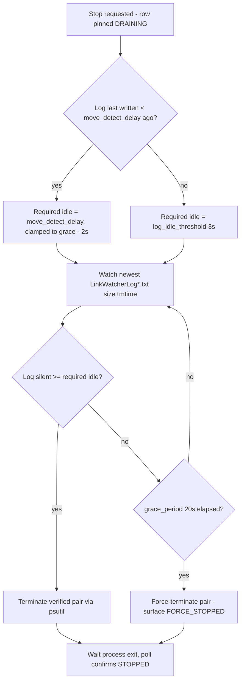

# Lightweight Technical Design Document: LinkWatcher Control Panel

## 1. Overview

### 1.1 Purpose

Technical design for the LinkWatcher Control Panel — the project's first GUI surface: a single-window Tkinter/ttk desktop application that lists every registered project's daemon state, starts and stops daemons, tails logs, views/edits per-project configuration, triggers link validation, and drains-then-terminates all managed daemons when the window closes. The panel is a **pure supervisor**: it introduces no new daemon-side contract (stop-sentinel deferred per [PD-FDD-034](../../../../functional-design/fdds/fdd-7-1-1-linkwatcher-control-panel.md)) and manages daemons entirely through existing external surfaces — the lock file, OS process state, the launcher script, the CLI's `--validate` mode, log files, and the per-project YAML config.

### 1.2 Related Features

- **0.1.1 Core Architecture** — provides the `main.py` CLI entry point and the `.linkwatcher.lock` per-project singleton lock (PID-bearing) that daemon identity resolution is built on.
- **0.1.3 Configuration System** — provides `LinkWatcherConfig.from_file()` / `.validate()`, which the config editor reuses for validate-on-save; the panel edits each project's `tools/linkwatcher/linkwatcher-config.yaml`.
- **3.1.1 Logging & Monitoring** — provides the per-project `logs/linkwatcher/LinkWatcherLog.txt` (with timestamp-rotated siblings) that the log pane tails and the drain heuristic watches.
- **6.1.1 Link Validation** — provides the `--validate` scan the Validation pane runs as a short-lived subprocess (no lock contention with the daemon).
- **`SessionStart` hook / launcher scripts** (process infrastructure, not a product feature) — `start_linkwatcher_background.ps1` remains the daemon start path; the hook wrapper additionally auto-opens the panel.

### 1.3 Workflow Context

**Workflows**: WF-010 (Manage running LinkWatcher instances via Control Panel — this feature is the workflow's sole UI surface), WF-009 (Link health audit — the panel is an alternative GUI trigger alongside `python main.py --validate`). Source: FDD Workflow Participation section.

## 2. Key Requirements

| ID | Requirement | Source |
|----|-------------|--------|
| KR-01 | Displayed daemon state always converges on real process state (external starts/stops included) within ≤ 5 s, and the panel never acts on a dead process or stale lock | FDD 7-1-1-FR-1/FR-4, EC-1/EC-3 |
| KR-02 | Stop and window-close drain in-flight daemon work before terminating, bounded by a configurable grace period (default 20 s) — the window can never hang on close, and forced termination is surfaced, never silent | FDD 7-1-1-FR-7, BR-3/BR-7, AC-9 |
| KR-03 | The panel only ever starts/terminates the correct per-project daemon pair — identification requires lock-PID + command-line + project-root agreement, and start goes through the existing launcher's singleton guards | FDD BR-1/BR-2, EC-2, AC-10 |
| KR-04 | Exactly one panel instance exists; a second launch (manual or hook auto-open) surfaces the existing window | FDD FR-8, BR-8, EC-9, AC-11 |
| KR-05 | Config edits are validated with LinkWatcher's own config loader before saving; invalid YAML is never persisted, and restart-needed is made explicit | FDD FR-9, BR-9, EC-10/EC-11, AC-12 |

## 3. Quality Attribute Requirements

> Feature has no Dimension Profile yet (Feature Implementation Planning runs after this TDD), so all subsections use standard Tier 2 depth. Reliability is the dominant attribute for this feature; Usability visuals are owned by the approved UI Design ([PD-UIX-003](../../../design/ui-ux/features/ui-design-7-1-1-linkwatcher-control-panel.md)) — this TDD owns their mechanics.

### 3.1 Performance Requirements

- **Response Time**: Displayed daemon state converges on real state ≤ 5 s (poll interval 2.5 s default). UI thread is never blocked by I/O — all process enumeration, drain waits, and subprocess runs happen off-thread; perceived UI latency for local interactions stays under ~100 ms.
- **Throughput**: N/A (single operator, no request load). The one rate-sensitive path is log tailing: appends must be incremental (never re-read the full file per tick) and must keep up with debug-level log bursts without visual churn.
- **Resource Usage**: Ambient footprint — near-zero CPU when idle (only the poll tick); log pane memory bounded by a fixed tail buffer (1,000 lines) regardless of log file size; no polling of logs for projects that aren't selected.

### 3.2 Security Requirements

- **Authentication / Authorization**: None — local, single-user desktop tool operating on the user's own processes and files (per tier assessment: standard security posture).
- **Data Protection**: No secrets, no network egress. The single-instance socket binds to `127.0.0.1` only and accepts a trivial fixed protocol (`SURFACE`), so it exposes no remote or data surface.
- **Input Validation**: Config editor text is validated (YAML parse + `LinkWatcherConfig.validate()`) before any write; registry and lock-file contents are treated as untrusted inputs (malformed → surfaced as error states, never crash).
- **Process-termination correctness** (the real security-adjacent concern): termination requires three-way agreement — lock-file PID, process command line containing `main.py`, and the project root in the command line — before any process is killed. A PID match alone is never sufficient (PIDs get recycled).

### 3.3 Reliability Requirements

- **Error Handling**: Every external surface can fail independently and is rendered as a pane-local error state (start failure with launcher reason, validation failure with subprocess reason, config read error, missing log) — one project's failure never takes down the panel or affects other rows.
- **Availability**: Panel crash or kill must leave daemons running and unharmed (daemons are fully independent processes; the panel holds no resource they need). No state is lost that cannot be rebuilt by the next poll.
- **Data Integrity**: Inherited from the daemon's atomic-write guarantee — even force-termination cannot corrupt a file; the bounded loss is in-flight move-correlations only (FDD BR-7). Config saves are write-temp-then-rename so an interrupted save never truncates the config.
- **Monitoring**: The panel *is* the monitoring surface; its own diagnostics go to a panel log (`<install>/logs/panel.log`, small rotating file) so panel misbehavior is diagnosable without a console.

### 3.4 Usability Requirements

- **User Experience**: Truthful-state principle from PD-UIX-003 — rows show transitional states (Starting…, Stopping — draining…) sourced from observed process state, never optimistic assumptions; all interactions ≤ 2 steps (select row → act).
- **Accessibility**: per PD-UIX-003 §5 — full keyboard operability (accelerators, arrow-key list navigation, visible focus) and glyph+text status pairing (never color-only). Screen-reader support is out of scope for this tool (single-operator internal utility).
- **Loading States**: Toolkit-native indeterminate progress for validation runs; determinate progress in the shutdown dialog; in-flight rows disable their action buttons until the transition resolves.
- **Error Messages**: Always state what failed and why, sourced from the failing surface (launcher stderr/exit code, subprocess output, YAML parse error with line number), rendered in the notice line / status bar / pane state per PD-UIX-003.

## 4. Technical Design

### 4.0 Component Architecture

New subpackage `src/linkwatcher/linkwatcher_control_panel/` (already scaffolded), plus a thin `control_panel.py` entry script beside `main.py` (mirrors the deployed flat install layout; the daemon CLI is untouched).

```mermaid
graph TD
    classDef critical fill:#f9d0d0,stroke:#d83a3a
    classDef important fill:#d0e8f9,stroke:#3a7bd8
    classDef reference fill:#d0f9d5,stroke:#3ad83f

    Entry[/control_panel.py entry script/] --> App([app.py - Tk root, wiring, shutdown orchestration])
    App --> SingleInstance([single_instance.py - localhost socket guard])
    App --> Model[(model.py - AppModel observable state)]
    App --> Views[views/ - main window, panes, shutdown dialog]
    Views -.-> Model
    Poller([discovery.py - poll thread: registry + locks + psutil]) --o--> Model
    App --> Lifecycle([lifecycle.py - start / drain / terminate])
    Lifecycle --> Launcher>start_linkwatcher_background.ps1]
    Lifecycle --> OSProcs>OS processes via psutil]
    Views --> LogTail([log_tail.py - incremental tail, rotation-aware])
    LogTail --> LogFiles[/logs/linkwatcher/LinkWatcherLog*.txt/]
    Views --> Validation([validation.py - --validate subprocess])
    Validation --> CLI>main.py --validate]
    Views --> ConfigEdit([config_edit.py - read / validate / atomic save])
    ConfigEdit --> Cfg[/tools/linkwatcher/linkwatcher-config.yaml/]
    Poller --> Registry[/child registry - project- or framework-registry.json/]

    class App,Lifecycle,Poller critical
    class Model,Views,SingleInstance important
    class LogTail,Validation,ConfigEdit reference
```

Threading model: **UI thread** (Tk mainloop) renders and dispatches; **poller thread** (discovery) and **per-action worker threads** (start, drain/stop, validation) do all blocking work and post results to a thread-safe queue that a `root.after(100)` dispatcher applies to the model on the UI thread. Tk widgets are only ever touched from the UI thread.

### 4.1 Data Models

All in-memory dataclasses — no persistence beyond the panel settings file (below). Rebuilt from external reality on every poll.

```python
class DaemonStatus(Enum):        # rendering + action enablement both key off this
    RUNNING, STOPPED, STARTING, DRAINING, FORCE_STOPPED, START_FAILED, STALE_LOCK

@dataclass
class ProjectInfo:               # one per registry entry (static per poll cycle)
    project_id: str              # e.g. "PRJ-001"
    name: str
    root: Path
    config_path: Path            # <root>/tools/linkwatcher/linkwatcher-config.yaml
    log_dir: Path                # <root>/logs/linkwatcher

@dataclass
class DaemonSnapshot:            # one per project, produced by discovery each poll
    project: ProjectInfo
    status: DaemonStatus
    pids: list[int]              # the verified process pair (may be 1 or 2 PIDs)
    started_at: float | None     # psutil create_time -> uptime rendering
    detail: str | None           # e.g. stale-lock tooltip text, start-failure reason

@dataclass
class ValidationRun:             # per project; persists until next run / project switch
    state: Literal["idle", "running", "ok", "broken", "failed"]
    broken_count: int | None
    report_path: Path | None
    error: str | None

class AppModel:                  # single observable model (PD-UIX-003 §10.2)
    snapshots: dict[str, DaemonSnapshot]   # keyed by project_id (selection survives refresh)
    validation: dict[str, ValidationRun]
    selected_project_id: str | None
    last_refresh: datetime
    shutting_down: bool          # global mode: disables all other interaction
    def subscribe(self, callback) -> None   # views re-render on change notification
```

**Panel settings** — `panel-config.yaml` in the install directory (beside `main.py`), loaded at startup, all keys optional:

```yaml
grace_period_seconds: 20      # drain upper bound (checkpoint-approved default)
log_idle_threshold_seconds: 3 # log silent this long => quiescent, UNLESS the daemon
                              # logged within its own move_detect_delay, in which case
                              # that window is the required silence instead (§4.4)
poll_interval_seconds: 2.5    # discovery cadence
project_registry: C:/path/to/project-registry.json   # optional override
```

Registry resolution order: `--registry` CLI arg → `LINKWATCHER_PROJECT_REGISTRY` env var → `project_registry` key in `panel-config.yaml` → **workspace-owned child registry** → **parent-pointer discovery** → error banner with guidance (distinct from the *empty registry* case, which is the calm EC-8 empty state). The two discovery tiers (pointer tier added during Core Logic Implementation Phase A, checkpoint-approved 2026-07-27; generalized by PD-BUG-148) keep the panel zero-config — the hook passes its own `--project-root`; a manual launch is answered by the current directory when it is a workspace root that owns a registry, and by the cwd walk-up from anywhere inside a leaf project — rather than introducing a second source of truth for the registry's location.

A workspace that **has children** keeps their registry in its own `process-framework-central/`, under a role-derived filename (`project-registry.json` indexing `projects` at a framework; `framework-registry.json` indexing `frameworks` at a framework-builder). Both filenames and both collection keys are recognized; the row schema is identical for the panel's purposes, which reads only `name` and `path`. A **leaf** workspace owns no child registry, so it resolves through the parent-pointer in its framework face (`.framework-parent-pointer`, or the legacy `.framework-central-pointer`) to the registry its parent owns. Either tier counts only when the resolved file exists, so an unreachable parent falls through to the error state rather than claiming a phantom path.

Two deliberate constraints (PD-BUG-148):

- **Own-registry lookup takes the cwd exactly, and never walks up.** The root is `--project-root` when given, else the current directory. Accepting an *implied* root is required for correctness, not convenience: the launchers forward their arguments and add none, so without it the tier was unreachable from every manual launch and a non-leaf workspace silently got its parent's registry (PD-BUG-148 CR-1; measured at appdev — own 4 projects vs. parent 3 frameworks, indistinguishable in the UI). Walking *up*, by contrast, would adopt a registry merely walked past: a producer's blueprint/template tree carries a zero-row *seed* registry, and resolving to it renders the calm "no registered projects" empty state, a wrong answer that reads as a valid one. Ancestors therefore keep pointer-only semantics. Two accepted residuals: a launch from a deep subdirectory of a non-leaf workspace still lists its parent's registry, and a launch from a blueprint tree root reaches that tree's seed. Both are diagnosable from the `registry resolved via <source>` line in `panel.log`.
- **The face location is read from the workspace, not assumed.** `paths.process_framework` in `doc/project-config.json` locates the framework face (a self-hosted producer keeps its face under `blueprint/`), falling back to `process-framework/` when undeclared or unreadable. The same resolution locates the per-project launcher script used by Start (§4.3).

Both recognized filenames and both collection keys are closed enumerations of the roles that exist today, so the next role divergence would repeat this bug's failure shape — a silent fall-through to the parent's list under an ordinary `registry resolved via pointer:` line. A `process-framework-central/` holding no recognized registry is therefore logged (`central_registry_unrecognized`, naming the directory and what was sought); the fall-through itself is unchanged. An unreadable parent-pointer is logged for the same reason, and `UnicodeDecodeError` is caught alongside `OSError` there — it is a `ValueError`, so it previously propagated out of resolution and aborted the panel before any window existed.

### 4.2 UI Components

Visual/interaction design is owned by [PD-UIX-003](../../../design/ui-ux/features/ui-design-7-1-1-linkwatcher-control-panel.md) (approved); this section maps its components to Tkinter/ttk widgets — the toolkit decision this TDD makes (**Decision D-T1**, checkpoint-approved: stdlib Tkinter over PySide6; zero new dependency, and the UI design's toolkit-conservative envelope requires only standard widgets. Accessibility fallback to Qt recorded in §8).

| PD-UIX-003 component | Widget realization | Technical notes |
|---|---|---|
| Main window shell (§2.2 Screen 1) | `tk.Tk` + `ttk.PanedWindow` (horizontal splitter) + toolbar `ttk.Frame` + status-bar `ttk.Label` | `WM_DELETE_WINDOW` protocol handler routes close → shutdown orchestration (§4.4), never direct destroy |
| Daemon list | `ttk.Treeview` (columns mode: Project / Status / Uptime) | Rows keyed by `project_id` — updated in place per poll (no rebuild → no flicker, selection survives); status cell = glyph + label text; per-status foreground via tags mapped to PD-UIX-001 tokens |
| Detail tabs | `ttk.Notebook` (Log / Configuration / Validation) | Tab content re-binds when list selection changes; unsaved-config guard intercepts the switch |
| Log pane | read-only `tk.Text` + `ttk.Checkbutton` (auto-scroll) | Appends via `insert('end')` + bounded-buffer trim; scroll-lock = auto-scroll pauses when user scrolls up (§4.5) |
| Config editor | `tk.Text` (editable, Consolas) + Save/Discard `ttk.Button` + notice `ttk.Label` | Dirty tracking via `<<Modified>>` event; save flow in §4.6 |
| Validation pane | `ttk.Button` + `ttk.Progressbar` (indeterminate) + state labels | State machine mirrors `ValidationRun.state`; one visible state at a time |
| Shutdown dialog | `tk.Toplevel`, modal (`grab_set`), no close button (`overrideredirect` avoided — use `protocol` no-op so the title bar stays native) | Per-daemon row labels + determinate `ttk.Progressbar`; exits app when all rows terminal |
| Empty / error states | centered `ttk.Label` blocks swapped into panes | One builder shared by all panes |

All widgets render from the model only (one-way); user actions never mutate widget state directly — they dispatch operations whose observed results update the model.

### 4.3 State Management

Single observable `AppModel` (one-way data flow, per PD-UIX-003 §10.2). Data flow per poll cycle and per user action:

```mermaid
graph TD
    classDef critical fill:#f9d0d0,stroke:#d83a3a
    classDef important fill:#d0e8f9,stroke:#3a7bd8

    Registry[/child registry - project- or framework-registry.json/] --> Poller([Poller thread, every 2.5s])
    Locks[/.linkwatcher.lock per project/] --> Poller
    Procs>psutil process table] --> Poller
    Poller --o--> Queue[(thread-safe queue)]
    Actions([Action workers: start / drain / validate]) --o--> Queue
    Queue --> Dispatcher([UI-thread dispatcher, root.after 100ms])
    Dispatcher --> Model[(AppModel)]
    Model --> Views[views re-render changed rows/panes]
    Views -->|user action| Actions

    class Poller,Model critical
    class Dispatcher,Actions important
```

- **Reconciliation rule**: the poller's snapshot is authoritative for RUNNING/STOPPED/STALE_LOCK; *panel-initiated transitional states* (STARTING, DRAINING) are pinned by the owning action worker and override poll results until the action resolves or times out — so a slow poll can't flicker a starting daemon back to "Stopped" (truthful-state requirement, FDD FR-4).
- **Transitional-state expiry**: every pinned state carries a deadline (start: launcher timeout + 5 s; drain: grace period + 5 s); if the deadline passes without resolution the pin is dropped and the poll truth wins — a hung action can never freeze a row permanently.
- **Selection & per-widget state** (splitter position, scroll-lock, dirty text, active tab) stay in the widgets/views — only shared operational state lives in the model.

### 4.4 Daemon Discovery & Lifecycle Control

**Discovery (per poll)** — for each registry project:

1. Read `<root>/.linkwatcher.lock` → candidate PID (absent → check for lockless orphans, below).
2. Verify via psutil: process exists **and** command line contains `main.py` **and** its `--project-root` argument names this project. Three-way agreement or it isn't that project's daemon (KR-03). The root test compares the **value** of `--project-root` after case-folding and separator normalization — not a literal substring of the command line. Two reasons, both observed during Core Logic Implementation Phase B: the registry stores `C:\…\LinkWatcher` while the running daemon's command line carries `c:\…\LinkWatcher`, so a literal comparison (what the launcher's `Test-LinkWatcherAlreadyRunning` does) misses the project's own live daemon; and a bare substring test would let root `C:\proj\App` match a daemon belonging to `C:\proj\AppExtra`. A process whose command line carries no `--project-root` (the flag defaults to the working directory, which is invisible in the command line) is unidentifiable and is therefore **never** claimed — the panel must never act on a process it cannot attribute. Refined again during the Code Review gap closure (2026-08-18, CR-4/CR-5): agreement is now **four-way**, because entry script + project root alone are also satisfied by a `main.py --validate` broken-link scan of the same project — a routine, documented workflow. Any flag that makes `main.py` do something and exit rather than run the watcher (`--validate`, `--version`, `--help`) disqualifies the process. Measured against the live process table: before this clause a real scan was claimed alongside the genuine daemon pair, so a stopped project rendered RUNNING and Stop or window-close would have terminated the scan mid-run and truncated its report. Relatedly, root extraction no longer regex-searches a *re-joined* argv: psutil always returns a split argv, so joining it only created false positives — a wrapper shell whose single quoted argument merely mentions `main.py … --project-root X` (the shape of `bash -c '…'` and the documented `pwsh -Command '& …'` form) was claimed as the daemon and became eligible for termination. The regex fallback now applies only to a genuine one-token command line.
3. Resolve the **process pair**: the daemon runs as venv-shim parent + base-interpreter child with near-identical command lines (established two-process pattern; the lock holds one of them). Discovery collects the verified process *plus* its parent/children that also match the command-line test — `pids` in the snapshot is the whole pair, and every lifecycle operation acts on the pair.
4. Classify, in this precedence order — **the process table is truth, the lock is diagnostic**:
   1. Lock PID passes the identity test and its pair is alive → RUNNING (uptime = oldest `create_time` of the pair).
   2. No lock-verified process, but the command-line scan (same rule as the launcher's `Test-LinkWatcherAlreadyRunning`) finds this project's daemon → RUNNING with a detail note explaining why the lock did not identify it — either *no lock file* (a genuine lockless orphan) or *a stale lock alongside a live daemon*. Refined during Phase B: checking the lock first would render a **running** daemon as not-running, leaving it unstoppable from its own supervisor — the precise blindness the panel exists to remove.
   3. A lock exists with nothing behind it — PID dead, PID recycled (alive but fails the identity test), or the lock is empty/corrupt → STALE_LOCK, rendered not-running with the reason, `pids` empty so nothing can be acted on (EC-1/EC-3).
   4. Neither → STOPPED. A registered project whose root no longer exists on disk is also STOPPED, carrying a "project root not found" detail so the row explains itself rather than silently vanishing from the listing (case not covered by the original four-way matrix).

**Start** — shell out to the project's own `process-framework/tools/linkWatcher/start_linkwatcher_background.ps1` (hidden window, captured output). This deliberately reuses the launcher's singleton guards, stale-lock reclaim, and crash disposition instead of reimplementing them; exit 0 = started/already-running (idempotent, EC-2/AC-10), exit 1 = START_FAILED with the captured stderr as the reason (EC-7). Row pinned STARTING until the poll observes the running pair.

**Stop / drain-then-terminate** (KR-02) — Windows offers no graceful cross-process signal (`terminate()` is a hard `TerminateProcess`; the daemon's SIGTERM handler is unreachable from another process), so drain is observational:



- The watcher targets the **newest** `LinkWatcherLog*.txt` in the project's log dir (rotation-safe — the active log may have been renamed).
- **Correlation-aware quiescence (PD-BUG-136, 2026-08-25).** Log-idleness alone is not a sufficient quiescence test: a daemon holding a buffered move-correlation writes *nothing* while it waits, so its `(path, size, mtime)` signature is byte-for-byte identical to an idle daemon's. With `log_idle_threshold_seconds` (3 s) below `move_detect_delay` (10 s), the drain deterministically terminated first and the pending update was silently dropped — measured at 3.3 s against a real daemon, versus 15.6 s and a preserved update after the fix. The drain now reads the project's own `move_detect_delay` and raises the required idle span to it. The fast path is kept by ageing the log at entry: a buffered delete expires exactly `move_detect_delay` after the `file_deleted` record that created it, so a log already silent for longer than the window cannot be hiding one, and a genuinely idle daemon still stops in ~3 s.
- The raised span is clamped to `grace_period − 2 s` so BR-7 still bounds the drain; a project whose `move_detect_delay` exceeds the grace period would otherwise force-stop on every single stop, and the clamp is logged (`drain_correlation_window_clamped`) rather than applied silently.
- **The window is re-armed on every observed log change**, not decided once at entry (PD-BUG-136 code-review finding F1). Ageing the log at entry is a statement about the instant the drain begins; the drain then runs for seconds, and a delete buffered inside that span opens a correlation the entry-time decision knows nothing about — measured: a log 60 s old at entry plus a delete logged 0.5 s in resolved `quiescent` at 3.50 s while the correlation stayed open until 10.50 s. The cost is deliberate and user-visible: a daemon logging more often than `move_detect_delay` never reaches the re-armed silence and now ends at the grace bound as **FORCE_STOPPED**, where it previously drained cleanly at the 3 s threshold. A clean stop now requires activity to have ceased by roughly `grace − window` (≈10 s) rather than `grace − idle` (≈17 s). That is the truthful outcome — such a daemon is still working, and surfacing a forced stop is exactly the PD-UIX-003 truthful-state principle — but operators of busy projects will see forced stops that used to read as clean.
- Residual limitations, still accepted by FDD BR-7 — atomic writes bound all of them to *dropped*, never corrupted, updates:
  - **Directory moves are covered only once the first file-creation event arrives** (PD-BUG-140, mechanism corrected 2026-08-26). The original report — and this bullet, until now — claimed a directory move correlates "over a window of up to 300 s, which no drain bounded by a 20 s grace period can outlast". Measured against the real `DirectoryMoveDetector` and the real drain, that is wrong: `_reset_settle_timer` fires `dir_move_settle_delay` (5 s) after the *last* match, which is inside the 10 s required idle span, so a correlation that has matched even one file always resolves before the drain — verified with a 15 s inter-create gap, where the drain held to 15.6 s and the move was processed. The `dir_move_max_timeout` **timer** (300 s, config key) is armed for *every* pending directory move (`dir_move_detector.py:108`), but a matched correlation is always resolved sooner by the settle timer, so 300 s is the **sole** bound only in the **zero-match** state; the **log record** of the same name is a different referent — it fires only on the partial-match branch (`dir_move_detector.py:368`) and never for this window, which closes with `directory_true_delete` instead. That zero-match state splits: a genuine directory *deletion* runs to the max timer and does in-memory bookkeeping only (`_process_dir_true_delete` → `_process_true_file_delete`), so terminating the daemon costs nothing; a slow-*starting* directory **move** — first `file_created` arriving later than the required idle span after `directory_deleted` — is the real exposure, because between `dir_move_buffered` and the first match the daemon writes nothing and is byte-for-byte an idle daemon. A same-volume Windows rename emits its creates in milliseconds; the window opens for cross-volume/network copies, very large trees, or a heavily loaded machine. Accepted as FDD 7-1-1-EC-12 rather than fixed — but only the *loss* is accepted, and the two halves close differently (corrected 2026-08-27, code-review finding F8; this bullet previously read "the panel cannot see pending correlations without a cooperative stop contract", which is the same claim D-T7 refutes and is wrong for the same reason). **Preventing** the loss does need a cooperative stop contract in which the daemon *holds* its stop: BR-7 bounds the drain while an unmatched correlation is bounded by nothing inside it, so no bounded drain can wait it out however well informed. **Detecting** it needs no daemon-side contract at all — the daemon already *reports* the pending work (`dir_move_buffered` at INFO), and reading it is panel-side work, deferred on its own cost (rotation, adopted daemons, multiple projects) and bounded by the daemon's `log_level`; that half is **PD-FRQ-020**, deferred rather than rejected. See D-T7 for both bounds. Pinned by `test_pd_bug_140_directory_correlation_drain_boundary.py`.
  - A project running at **`log_level: WARNING` or `ERROR` loses the protection entirely** (finding F2): `file_deleted` is INFO (`logging.py:561`), so the daemon writes nothing while it buffers, the log always ages past the window, and the drain takes the 3 s fast path. The panel cannot distinguish that from a genuinely idle daemon without reading the project's `log_level`, which it does not do. (Since PD-BUG-142 the panel *does* resolve the project's configuration through `LinkWatcherConfig`, so reading `log_level` the same way is now cheap — the remedy exists, it is simply not wired up.)
  - A daemon the panel **adopted rather than started** may be running under a different environment than the panel's own (PD-BUG-142). The correlation window is resolved from the config file plus the *panel process* `LINKWATCHER_MOVE_DETECT_DELAY`; for an adopted daemon launched from a different shell with a different value, that is not the span that daemon actually uses. Accepted rather than fixed: it needs three conjoined conditions — a non-default `LINKWATCHER_MOVE_DETECT_DELAY` (no occurrence anywhere in the product, launchers, installer, docs or config examples), set for the daemon but not for the panel (the panel auto-opens from the same hook wrapper that starts the daemon, and a machine-wide variable is seen by both), *and* a move in flight at close. Closing it needs the daemon to publish its effective configuration on a channel the panel can read; the two obvious channels do not work — the lock body is parsed as a bare integer by four readers across two languages, and a log record inherits the `log_level` residual directly above.
- The daemon's own `release_lock()` never runs on `TerminateProcess`, so after confirmed exit the panel deletes the lock **only if** it still contains the terminated PID (same self-owned-lock rule as `main.py`).
- **The delete is retried** (PD-BUG-137, 2026-08-25). Windows cannot unlink a file another handle holds open without `FILE_SHARE_DELETE`, so a single attempt loses to any concurrent holder — the panel's own poller mid-read (it reads every project's lock each cycle and keeps polling throughout shutdown), an antivirus scan of a just-terminated process's files, the search indexer. Measured with a continuous reader: 208/300 unlinks failed. Escalating backoff totalling ~1.05 s; at a conservative poller-cadence stand-in it removed 150/150 locks where a single attempt lost 19. It is a probability reduction, **not** a guarantee — a holder outlasting the budget still wins, and the downstream defences stay the backstop (`main.py` reclaims a dead-PID lock; discovery surfaces STALE_LOCK). A lock that is ours and still undeletable is now surfaced (`lock_cleanup_failed`, naming the OS error) instead of collapsing into the same bare `False` as a deliberately untouched foreign lock — the absence of that distinction is why the original incident could not be diagnosed from the panel log.
- **Window close** runs the same drain per daemon, in parallel worker threads, behind the modal shutdown dialog; the app exits when every row reaches STOPPED/FORCE_STOPPED — bounded by the grace period, so close can never hang (AC-9).

### 4.5 Single Instance, Auto-Open & Log Tail

**Single instance** (KR-04): on startup, bind a `127.0.0.1` TCP socket on an ephemeral port and write the port to `<install>/panel.port` (atomically — same-directory temp + `os.replace`). A second launch reads the port file, connects, sends `SURFACE\n`, and exits; the first instance's listener thread posts a surface request to the UI thread (`deiconify` + `lift` + focus, with a `ctypes` `SetForegroundWindow` assist — Windows foreground-lock permitting, the window at minimum flashes in the taskbar). A launch classifies what it found at the published port three ways: the panel answered (surfaced, exit), something is listening but would not confirm (declined), or nothing is listening (stale port file). Both of the latter take over, and they are logged as the different events they are — see the confirmation paragraph below. This one mechanism covers both the single-instance rule and hook auto-open focus (EC-9/AC-11).

An incumbent is believed only when it **answers the handshake** with `LINKWATCHER-PANEL OK\n` (implementation refinement, Phase F): ephemeral ports are recycled, so a stale port file can name a port an unrelated process now owns, and treating a bare successful connect as "already running" would block the panel from ever opening again. The ack is what makes "connect failure ⇒ stale" trustworthy. Two further properties: bind failure is **fail-open** (the panel opens unguarded rather than not at all), and the port file is deleted on exit only when it still holds this instance's port — the self-owned-resource rule used for `.linkwatcher.lock` (§4.4). Simultaneous launches within the same few milliseconds can both acquire (two windows, never more); accepted as a Known Limitation rather than adding a second exclusion primitive.

The ack is sent **after the window has actually surfaced, never before** (PD-BUG-157, 2026-08-31). The banner is the launching process's only evidence that a window reached the operator, so ordering it first proved merely that a *listener thread* was alive — not that a mainloop was running, that the dispatcher queue was ever drained, or that a window existed. An incumbent whose UI was dead, wedged, or not yet wired therefore absorbed every relaunch: the launcher was told "already running", exited 0, and no window appeared, leaving hand-deletion of `panel.port` as the only recovery. The listener now runs the surface hook, waits for the UI thread to report that it ran (`SURFACE_CONFIRM_TIMEOUT_SECONDS`, 1.5 s — deliberately under the client's 2 s handshake timeout so a declining incumbent is still heard), and only then sends the banner; no confirmation means **silence**, which the client reads as "no live panel" and opens a real window. That 1.5 s is the budget for the **whole** response, not per phase: the wait for a not-yet-wired hook and the hook's own confirmation share one deadline, and the listener bounds its own wait rather than trusting the hook to respect the budget it is handed. Giving each phase a full budget made them additive — up to 3.0 s against a client that stops listening at 2.0 s, with every individual wait still "inside budget" — so the launcher timed out on a panel that *was* surfacing, opened a duplicate, and rewrote `panel.port` over the live incumbent, re-creating this bug's own failure class from the decline path (found at code review, 2026-08-31). For the same reason each request is served on its own short-lived thread: serving them inline on the accept loop made simultaneous launches queue behind one another's raise, so on a *healthy* panel the last of three concurrent launches timed out and duplicated the window. A takeover of a port that is still occupied is logged as `surface_declined`, never as `stale_port_file` — the operator needs to know a second window now exists and the incumbent has lost its route back. The same budget covers a panel still *building* its window — a second launch can arrive before `on_surface` is wired (observed 337 ms after acquire, with the window ready at 632 ms), and refusing that request would open a duplicate — so a not-yet-wired hook is waited for rather than dropped. What this proves is that the UI thread executed the raise **and that the raise succeeded** (PD-BUG-159, 2026-09-01). `ControlPanelApp.surface` reports its outcome and the hook sets its event only on success, so a raise that throws — a root already destroyed, a Tk that has failed — leaves the event unset and the guard declines the ack. Reporting only that the raise *ran* acked a window that was not there while the same panel logged `surface_failed`; the exception is still swallowed, because surfacing must never kill the panel, but the outcome now reaches the caller. A refused **foreground** grab is not a failure in this sense: the window is up and only the activation was denied, which remains the foreground-lock floor described above (taskbar flash).

The claim itself is dropped the moment the panel **commits to exiting**, before anything is drained (PD-BUG-160, 2026-09-01). Confirmation makes the ack honest about the present; it says nothing about whether the window will still be there when the launching process exits. `_on_close` starts the drain-then-terminate shutdown while the mainloop and dispatcher pump keep running, so throughout that shutdown — up to `grace_period_seconds` plus `WATCHDOG_MARGIN_SECONDS`, ~35 s at defaults — the listener kept answering and the raise genuinely succeeded. The launcher was told "already running" about a window that was seconds from being destroyed, and once the drain finished no panel existed at all; a further relaunch worked, because `release` had removed `panel.port` by then, so the state was self-healing rather than a lockout. `ControlPanelApp` therefore exposes `on_shutdown_begin`, which `control_panel.main` wires to `guard.release` — a mutable attribute for the same wiring-order reason as `on_surface`. A launch arriving during a drain then finds no published port at all, so it takes neither the `stale_port_file` nor the `surface_declined` branch: there is nothing left to probe, and it simply binds and opens a window. Dropping the claim is best-effort and never fatal — a failure there is logged as `shutdown_claim_release_failed` and leaves the pre-fix behaviour, because a window the operator has asked to close must close regardless. `release` is idempotent and self-owned-port-checked, so the `finally` in `main` stays correct and a successor that has already taken the file over is left alone. **Accepted consequence**: for the duration of a drain two windows may exist, the departing one and the new one — a bounded departure from EC-9 recorded there as its second exception, on the same reasoning as the first.

**Hook auto-open** (FR-8): `start_linkwatcher_hook_wrapper.ps1` gains one detached, non-blocking call that launches the panel via the install venv's `pythonw.exe` (no console window). Idempotent by construction — a running panel just gets surfaced. The hook must not wait on the panel process (session start latency unchanged).

> **⚠️ Status (2026-08-18): NOT IMPLEMENTED.** The design above still stands, but the change does not exist. It was implemented and live-verified on 2026-08-10, never committed (feature 7.1.1 was untracked in git until 2026-08-17), and then reverted by the 2026-08-14 framework rollout. Verified at Code Review and again during the gap closure: `start_linkwatcher_hook_wrapper.ps1` carries no `pythonw` / `control_panel` / `Open-ControlPanel` reference in the working tree, at HEAD, or anywhere in git history. Re-implementation is tracked as **PF-IMP-2032** and must run through Process Improvement — the file is on the framework path, so a local edit is reverted by the next rollout. **FR-8, UI-7, BR-8 and the first clause of AC-11 are therefore UNMET**, and the panel's single-instance surfacing (the second clause) is what remains delivered.

**Log tail** (FR-5/EC-5): on selection, seek to `max(0, size - 64 KB)` and render the tail; thereafter a 500 ms UI-timer tick reads only appended bytes. Rotation/truncation detection: current file missing or size shrank ⇒ reattach to the newest `LinkWatcherLog*.txt` from the start. Display buffer capped at 1,000 lines (trim from top). No-log ⇒ placeholder state, never an error dialog.

### 4.6 Validation & Config Editing

**Validation** (FR-6/BR-6/EC-6): worker thread runs `<install-venv-python> main.py --validate --project-root <root>` plus `--config` when the per-project config exists (mirroring `run_linkwatcher_validate.ps1` semantics). `--validate` takes no lock, so the running daemon is untouched. Exit 0 → ok (0 broken); exit 1 with report → broken count parsed from the report/output, report path = `logs/linkwatcher/LinkWatcherBrokenLinks.txt`; nonzero with no report / spawn failure → failed with captured stderr. One run per project at a time (button disabled while running).

**Config editing** (KR-05): load raw text of `tools/linkwatcher/linkwatcher-config.yaml` (missing/unreadable → EC-10 read-error banner, editor disabled, "Create default config" action writes a minimal commented skeleton). Save pipeline: `yaml.safe_load` (parse errors reported with line numbers) → construct `LinkWatcherConfig` from the dict and run its `validate()` (reusing feature 0.1.3's rules — no second validator to drift) → write temp file in the same directory + `os.replace` (atomic; an interrupted save never truncates, and LinkWatcher's own-move handling sees a normal edit) → notice line. Restart-needed: the daemon reads config only at startup, so the "⚠ Saved. Restart the daemon to apply changes." notice shows **whenever the project's daemon is currently running** (BR-9) — no per-key hot-apply analysis in the MVP.

### 4.7 Quality Attribute Implementation

#### Performance Implementation

- All blocking work (psutil enumeration, subprocess runs, drain waits, file reads) on worker threads; the UI thread only renders queued model updates (§4.3) — meets the ≤ 100 ms interaction target by construction.
- Convergence ≤ 5 s from the 2.5 s poll plus in-place `Treeview` row updates (no rebuild).
- Log tail reads appended bytes only, renders into a 1,000-line capped buffer, and ticks only for the selected project (§4.5) — bounded memory and instant open on arbitrarily large logs.
- Poll cost is one registry read + one psutil pass per tick; with single-digit registered projects this is negligible (idle CPU target).

#### Security Implementation

- Three-way process identification before any terminate; lock deletion only when the lock still holds the terminated PID (§4.4).
- Single-instance socket: loopback bind, fixed one-verb protocol, no data accepted beyond the `SURFACE` token (§4.5).
- Config writes only after LinkWatcherConfig validation; atomic replace prevents partial writes (§4.6). Registry/lock contents parsed defensively.

#### Reliability Implementation

- Drain-then-terminate bounded by the 20 s grace period with visible FORCE_STOPPED surfacing (§4.4); shutdown dialog exits deterministically.
- Transitional-state pins carry deadlines so a hung action degrades to poll truth instead of freezing a row (§4.3).
- Per-surface error isolation: each pane renders its own failure state; worker-thread exceptions are caught, logged to the panel log, and rendered — never propagated to the mainloop.
- Panel holds no daemon-critical resource: crash-safety of daemons under panel failure is structural, not coded.

#### Usability Implementation

- Truthful state: rendered status is always poll-observed or a deadline-bounded pin — never an optimistic assumption (§4.3).
- Action enablement derives from `DaemonStatus` per row (Start only when STOPPED/STALE_LOCK, Stop only when RUNNING), matching PD-UIX-003 toolbar rules.
- Keyboard accelerators, focus order and glyph+text status tokens implemented per PD-UIX-003 §4–5; strings centralized in one module (single-language, per PD-UIX-003 §10.4).

## 5. Cross-References

### 5.1 Functional Requirements Reference

> **📋 Primary Documentation**: FDD Creation Task (PF-TSK-027)
> **🔗 Link**: [Functional Design Document — PD-FDD-034](../../../../functional-design/fdds/fdd-7-1-1-linkwatcher-control-panel.md)
> **👤 Owner**: FDD Creation Task

**Brief Summary**: Nine functional requirements covering the daemon list, start/stop, live log view, validation trigger, config view/edit, drain-then-terminate on window close, and hook auto-open — under the panel-owned shutdown lifecycle model (close = drain and terminate all managed daemons). This TDD implements those behaviors; requirements, business rules, and acceptance criteria are owned there and referenced by ID throughout §2 and §4.

### 5.2 UI Design Reference

> **📋 Primary Documentation**: UI Design Task (PF-TSK-090)
> **🔗 Link**: [UI/UX Design Document — PD-UIX-003](../../../design/ui-ux/features/ui-design-7-1-1-linkwatcher-control-panel.md) (approved 2026-07-12)
> **👤 Owner**: UI Design Task

**Brief Summary**: Master–detail single window with tabbed Log/Configuration/Validation panes, five wireframed screens, seven component specs, and the toolkit-conservative widget envelope this TDD's Tkinter decision satisfies. Visual tokens, spacing, accessibility requirements, and interaction behavior are owned there; §4.2 maps its components to concrete widgets.

### 5.3 API Specification Reference

> **📋 Primary Documentation**: API Design Task (PF-TSK-020) — **not invoked for the MVP**
> **👤 Owner**: N/A

**Brief Summary**: No new API contract — the panel wraps existing surfaces only (CLI incl. `--validate`, launcher script, OS process APIs, log files, config file). Standing caveat from PD-ASS-201: adopting the deferred **stop-sentinel** graceful-stop mechanism later would introduce a UI↔daemon Service-Interface contract and trigger API Design at that point.

### 5.4 Database Schema Reference

> **📋 Primary Documentation**: Database Schema Design Task (PF-TSK-021) — **not applicable**
> **👤 Owner**: N/A

**Brief Summary**: No database. The only persisted panel state is the optional `panel-config.yaml` settings file and the transient `panel.port` single-instance file (§4.1, §4.5).

### 5.5 Testing Reference

> **📋 Primary Documentation**: Test Specification Creation Task (PF-TSK-012)
> **🔗 Link**: Test Specification — *pending (next step; feature tracking now shows 🧪 Needs Test Spec)*
> **👤 Owner**: Test Specification Creation Task

**Brief Summary**: The design isolates every hard-to-test boundary behind a small module with an injectable seam: discovery classification (fabricated lock/process fixtures for EC-1–EC-3), drain logic (fake log-mtime source + fake clock for BR-7/AC-9 without real 20 s waits), lifecycle (launcher invocation mockable), and config save pipeline (temp fixtures). UI-state truthfulness is testable by driving `AppModel` directly, without a display.

## 6. Implementation Plan

### 6.1 Dependencies

All runtime dependencies already exist — nothing must be implemented first:

- Features 0.1.1 (CLI + lock), 0.1.3 (config loader/validator), 3.1.1 (log files), 6.1.1 (`--validate`) — all 🟢 Completed.
- `psutil >= 5.9.0` — already in `pyproject.toml`; Tkinter — stdlib. **No new packages.**
- A child registry — `project-registry.json` at a framework, `framework-registry.json` at a framework-builder — consumed read-only.
- `start_linkwatcher_hook_wrapper.ps1` — small additive change (panel auto-open call) inside this feature's scope. **Not delivered** — see the §4.5 status note; tracked as PF-IMP-2032 on the framework path.

### 6.2 Implementation Steps

1. **Panel skeleton + settings**: `control_panel.py` entry, `app.py` Tk root, `panel-config.yaml` loading, registry resolution chain, panel log. Window shell per PD-UIX-003 Screen 1 (empty states only).
2. **Discovery + model + list**: `discovery.py` poll thread with the classification rules (§4.4), `AppModel` + dispatcher queue (§4.3), live daemon list with status rendering — the panel becomes a truthful read-only monitor.
3. **Lifecycle actions**: start (launcher shell-out) and stop (drain watcher + pair termination + lock cleanup), transitional-state pins with deadlines, toolbar enablement.
4. **Shutdown orchestration**: `WM_DELETE_WINDOW` → modal dialog → parallel drains → deterministic exit (AC-7/AC-9).
5. **Detail panes**: log tail (§4.5), validation subprocess (§4.6), config editor with validate-on-save pipeline (§4.6).
6. **Single instance + hook auto-open**: socket guard, surface protocol, `pythonw.exe` hook-wrapper addition (§4.5).
7. **Hardening pass**: all EC-1…EC-11 states exercised against fixtures; worker-error isolation; the remaining component/state-logic tests.

Steps 1–2 are the natural first session; each step leaves the panel in a runnable, demonstrable state.

## 7. Quality Measurement

### 7.1 Performance Monitoring

- Poll-cycle duration and dispatcher-queue depth logged (DEBUG) to the panel log — a growing queue or >500 ms polls flags a responsiveness problem before the user feels it.
- Convergence target verified in tests: externally started/stopped fixture process reflected in the model within 2 poll cycles.
- Log-tail behavior verified against a large (>50 MB) fixture log: open time and per-tick read bounded.

### 7.2 Security Validation

- Unit tests for the termination guard: PID-recycled process (right PID, wrong command line), foreign lock, and dead-PID lock must all refuse to terminate (EC-1/EC-3 fixtures).
- Config save tests: invalid YAML and invalid values never reach disk; interrupted-save simulation leaves the original file intact.

### 7.3 Reliability Monitoring

- Panel log (WARN+) records every forced termination, start failure, validation failure, and caught worker exception — the record for diagnosing "why was my daemon force-stopped".
- Drain outcomes are also visible operationally in the shutdown dialog and status bar (PD-UIX-003); the E2E acceptance path for AC-8/AC-9 exercises drain with an in-flight move fixture.

### 7.4 User Experience Metrics

- Success criteria from PD-UIX-003 §1.1 applied at E2E acceptance: every FDD interaction achievable keyboard-only; close never hangs; forced stops visibly reported.

## 8. Open Questions

2. ~~**Registered-projects source of truth**~~ — **RESOLVED (Phase B, 2026-07-31): show everything the registry lists; no filtering.** The registry's `version_freeze` flag marks a project as excluded from *framework rollouts*, which says nothing about whether a LinkWatcher daemon runs there — appdev is frozen and demonstrably runs one. Filtering on it would hide a live daemon from its only supervisor. A registered project whose root is missing from disk is still listed, as STOPPED with an explanatory detail (§4.4 step 4).
3. ~~**Broken-link count extraction**~~ — **RESOLVED (Phase E, 2026-08-10, checkpoint-approved): both, each for what it is stable at.** The report *path* is parsed from stdout's `Report written to <path>` line (ANSI-stripped — the CLI prints colored output), falling back to the conventional `logs/linkwatcher/LinkWatcherBrokenLinks.txt`; the *count* comes from the report file's stable, colorless `Broken links  : N` summary line, falling back to the same line in stdout. The report file is the more stable surface; stdout remains the locator, consistent with the validate launcher's "the report location is owned by the build" stance. Exit 1 with no locatable report is a `failed` state, never a result (EC-6).
   **Amended 2026-08-19 (PD-BUG-132):** the conventional-path fallback resolves a *path*, and was mistaken here for evidence of a *run*. The validator writes that path on every completed run, so for any project validated even once a report is always present — and a run that exits 1 *before* scanning (invalid config, invalid project root, an exception inside the scan) was therefore handed the previous run's report and rendered as a link-health verdict, discarding the error. The `broken` state now additionally requires positive evidence from this run's own stdout that the scan completed: the `Report written to` locator **or** the `Broken links : N` summary line, either of which `--validate` prints only after the scan. The fallback is kept, now strictly as a path resolver. A `failed` state also reports the validator's own diagnosis (the `config_issue` payloads, else the error lines) rather than the first 300 characters of a stream that opens with startup logging — naming the offending key is the point of surfacing the failure at all.

## 9. AI Agent Session Handoff Notes

This section maintains context between development sessions:

### Current Status

Design, test spec, and implementation plan complete. Implementation is under way per §6.2 — **steps 1–5 done** (Core Logic Implementation Phases A–D complete 2026-08-10; UI Implementation Phase E complete 2026-08-10): settings + registry resolution, panel log, window shell, `model.py`, `discovery.py`, the live daemon list, `lifecycle.py` (start via launcher shell-out, observational drain, kill-time-guarded pair termination, self-owned lock cleanup, toolbar enablement), the close path (`ShutdownOrchestrator` + modal shutdown dialog + watchdog, AC-7/AC-9), and the three detail panes — `log_tail.py` (§4.5: 64 KB window, appended-bytes polls, rotation reattach, 1,000-line buffer, CRLF-safe), `validation.py` (§4.6 + Q3 resolution: `--validate` subprocess mirroring the validate launcher, per-project busy guard), `config_edit.py` (§4.6: safe_load → same-dir temp → real `LinkWatcherConfig.from_file()`+`validate()` on the exact persisted bytes → atomic `os.replace`), their `views/` panes with the unsaved-changes guard and keyboard accelerators (Ctrl+1/2/3, Ctrl+S, Ctrl+End). Verified live three times: start + clean drain-stop of a registered project's daemon (Phase C), close-with-running-daemon exiting by itself in under 5 s (Phase D), and a scripted real-Tk run of the panes against a synthetic project incl. a real `--validate` subprocess (Phase E, 14/14 checks). **Step 6 also done** (Integration & Testing Phase F complete 2026-08-10): `single_instance.py` (§4.5 — loopback bind, atomically published `panel.port`, `SURFACE`/banner handshake, fail-open bind, self-owned release), `app.surface()`, the hook wrapper's detached `pythonw.exe` auto-open, and the installer changes that ship the panel. Verified live: the hook wrapper returned in 2.4 s with stdout captured through a pipe (no inherited-handle hang), and a repeat launch surfaced the existing window instead of opening a second (AC-11). **Step 7 is also done** (Integration & Testing Phase G, 2026-08-10): the EC sweep, INT-8, COMP-2/COMP-8, the toolbar accelerators, and the hook wrapper's all-exit-paths auto-open — see the feature state file §9 Decision 11. **All seven implementation steps are complete**; the feature moves to Implementation Finalization and Code Review.

Live state, per-phase progress, and implementation decisions are tracked in the feature state file ([PD-FIS-056](../../../../state-tracking/features/7.1.1-LinkWatcher-Control-Panel-implementation-state.md)) — this section records only the design-side status.

### Next Steps

1. ~~**Step 6 — Single instance + hook auto-open**~~ — **DONE (Phase F, 2026-08-10)**. Deployment note: shipping the panel required `psutil` and `GitPython` to be declared as runtime dependencies and the installer to emit a `requirements.txt`; see the feature state file §10.
2. ~~**Step 7 — Hardening**~~ — **DONE (Phase G, 2026-08-10)**. EC-1…EC-11 swept with a traceability table in the test spec (two gaps closed: EC-7's "the list stays truthful" half and EC-8's rendering half); INT-8 worker-error isolation across start / stop / validation / discovery plus the UI-thread dispatcher (the drain was extracted to a module-level `drain_queue` so the rule is assertable without Tk); COMP-2 and COMP-8; the §4.7 toolbar accelerators wired and gated on button enablement, verified against a real window. One defect found and fixed: the list pane rendered the empty state during the first (measured 7.5 s) `psutil` pass, asserting "no registered projects" before discovery had reported; `views/rendering.py` now selects an explicit wait state until the first poll lands.

### Key Decisions

- **D-T1 — Tkinter/ttk over PySide6** (checkpoint-approved 2026-07-12): zero new dependency; UI design's widget envelope needs nothing more. Confirmed 2026-08-12 — the PySide6 fallback is withdrawn; the model/view split is retained because it is what makes the view rules testable without a display, not as a toolkit escape hatch.
- **D-T2 — Grace period 20 s, configurable** via `panel-config.yaml` (checkpoint-approved): covers one 10 s move-correlation window + apply time. Drain quiescence = newest log file silent ≥ the required idle span — `log_idle_threshold_seconds` (3 s) normally, raised to the project's `move_detect_delay` when the log was written recently enough for a correlation to still be open (§4.4). The original rule used the 3 s threshold unconditionally, which meant the grace period this decision sized to cover a correlation window was never reached — quiescence always fired first (PD-BUG-136).
- **D-T3 — Localhost-socket single instance** with `panel.port` file (checkpoint-approved): one mechanism for both single-instance and hook auto-open surfacing. Refined in Phase F (checkpoint-approved 2026-08-10): an incumbent must answer a fixed banner handshake, since a recycled port would otherwise block the panel permanently; simultaneous-launch double-acquire accepted as a Known Limitation.
- **D-T4 — Start via the existing launcher script**, never a direct daemon spawn — reuses singleton/stale-lock/crash-disposition logic.
- **D-T5 — Termination requires four-way identity agreement** (lock PID + `main.py` in command line + project root + *not* a non-daemon run mode) and always targets the two-process pair. The root leg compares the normalized *value* of `--project-root`, an unattributable process is never claimed, and a process running an exit-mode flag (`--validate` / `--version` / `--help`) is never claimed however well the other legs match (§4.4 step 2; root-value leg refined during Phase B, run-mode leg and the raw-argv fallback restriction added 2026-08-18 for CR-4/CR-5).
- **D-T6 — Config validation reuses `LinkWatcherConfig.validate()`** — no parallel validator to drift; saves are atomic (temp + `os.replace`).
- **D-T7 — BR-3 yields to BR-7; the data-loss half of unobservable in-flight work is out of scope** (checkpoint-approved 2026-08-26, alternatives corrected 2026-08-27, resolving PD-BUG-140). FDD BR-3 ("the daemon is allowed to finish buffered move-correlations") and BR-7 ("drain is bounded") are in genuine tension for any work the drain cannot wait out, because the panel infers quiescence from the daemon's own log *signature* and has no control channel into the process. The decision is that **BR-7 wins**: the drain stays bounded, and BR-3 is a best-effort within that bound rather than a guarantee.

  The alternatives, and why the data-loss half is genuinely closed off while the observability half is only deferred:

  - **Untargeted warn-on-close** — rejected. A warning that cannot name a pending correlation fires on every close and is trained away within a day.
  - **Daemon-side heartbeat while a correlation is open** — rejected. It would re-arm the drain into the grace bound, converting clean stops into forced ones and paying that cost on every genuine directory deletion, which is the common case.
  - **Targeted warn-on-close, driven by the daemon's existing log records** — **viable at INFO or below; deferred, not rejected.** This option was missed when D-T7 was first written, and the reasoning given for rejecting warn-on-close was wrong: it claimed the panel has no pending-work signal, when the daemon logs `dir_move_buffered` at INFO (with `deleted_dir` and `known_file_count`) and emits terminal records — `dir_move_processing`, `directory_true_delete`, `dir_move_max_timeout` — that say when the correlation closed. The panel already reads log *content* elsewhere (`log_tail.py`), though the drain itself consumes only the `(path, size, mtime)` signature, so this is real work rather than a wiring change: it must handle rotation, daemons the panel adopted but never started, multiple projects, and a tail window that may hold the buffering record without its terminal one.

    **Bounded by the daemon's `log_level`** (2026-08-27, code-review finding F7). Every record this option keys on is INFO — the opening `dir_move_buffered` / `dir_move_batch_size` pair, and the `dir_move_processing` / `directory_true_delete` records that close the correlation. A stdlib logger gates on its own level *before* any handler runs, so at `log_level: WARNING` or `ERROR` none of them reaches the **file** log either, even though the file handler sits at DEBUG (measured, not inferred; pinned by `test_pd_bug_140_directory_correlation_drain_boundary.py`). The one survivor is the `dir_move_max_timeout` **log record** (WARNING) — not the config timer of the same name, which is armed for every pending move (§4.4): the record is emitted only on the partial-match branch and never for this window, which closes with `directory_true_delete` at INFO. The option is therefore *fully* blind at exactly the levels where §4.4's second residual already records the drain protection as lost entirely — and that is the shipped `PRODUCTION_CONFIG` preset and `config-examples/production-config.yaml`, not a hypothetical. What it can still do there is **know** that it is blind: since PD-BUG-142 the panel resolves the project's configuration in-process, so reading `log_level` through that same chain — the remedy §4.4 already notes as available but unwired — lets it report *"cannot determine"* rather than a false clean, and it inherits that fix's adopted-daemon residual. Raising the daemon's buffering record above INFO would close the blindness outright, but that is daemon-side product work rather than a panel change; it is recorded as an option on the request, not chosen here.

    **The deferral is on cost, not on a dependency** (corrected 2026-08-27, closing TD299). This bullet previously deferred the option because [PD-BUG-142](../../../../state-tracking/permanent/bug-tracking.md)'s approved fix "already builds a daemon→panel publication channel". It does not. That fix's scope was **reassessed downward at its Step 13 with human approval**, precisely because neither candidate channel closes the class — the lock body is parsed as a bare integer by four readers across two languages, and a log record inherits the `log_level` residual above. What shipped resolves configuration *in-process* in the panel, and `read_correlation_window`'s own docstring still puts the publication channel in the future tense. There is no channel to sequence behind: PD-FRQ-020 is independent work, deferred on its own cost (the rotation / adoption / multi-project handling above), not on another change landing first. Tracked as **PD-FRQ-020**, whose Notes carry the same bound.
  - **Cooperative stop sentinel** — deferred (FDD Notes); it introduces the API contract the panel design exists to avoid.

  The distinction that matters: the daemon already **reports** its pending work, so *detecting* the condition needs no new contract — at INFO or below, per the `log_level` bound above. What no bounded drain can do is **wait it out** — BR-7 bounds the drain while an unmatched correlation is not bounded by anything within it. Closing the data-loss half therefore requires the daemon to *hold* its stop, not merely to report; closing the observability half does not. FDD 7-1-1-BR-3 was amended and 7-1-1-EC-12 added to state this honestly rather than leaving the FDD promising something no bounded drain can deliver. The residual is bounded by atomic writes (dropped, never corrupted) and recoverable via a validation scan.

### Known Issues

- Log-idle drain is a heuristic, and it can only cover work the daemon makes observable. Per-file move-correlations are now covered (§4.4, PD-BUG-136). A **directory** move is covered from its first matched creation onward, but the window between the buffered directory delete and that first match is silent and therefore invisible to the drain (PD-BUG-140, §4.4); so is any correlation still open at force-terminate. The *loss* is accepted and bounded by FDD BR-7 / EC-12 (atomic writes; dropped, never corrupted; recoverable via a validation scan). Its *invisibility* — the stop still reporting clean — is not accepted, only deferred: see D-T7 and PD-FRQ-020, including the `log_level` bound that leaves the deferred detection blind above INFO.
- Files to create: `control_panel.py` (install root) and modules under `src/linkwatcher/linkwatcher_control_panel/` (`app.py`, `model.py`, `discovery.py`, `lifecycle.py`, `log_tail.py`, `validation.py`, `config_edit.py`, `single_instance.py`, `settings.py`, `views/`). File to modify: `process-framework/tools/linkWatcher/start_linkwatcher_hook_wrapper.ps1` (auto-open call); `deployment/install_global.py` must ship the new entry script.
